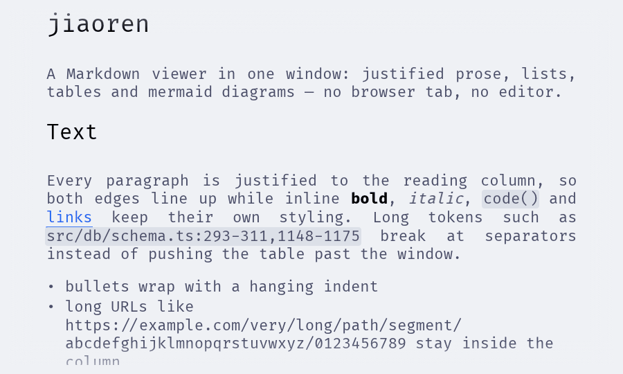

# jiaoren

A zathura-like Markdown viewer. `jr doc.md` opens one window showing the
rendered Markdown — the way `zathura doc.pdf` does for PDFs — with ```mermaid
fences drawn as real diagrams.

Keyboard-first, almost no chrome, live-reloads when the file changes on disk.



## Why "jiaoren"?

**鲛人** (jiāorén) is the merfolk of Chinese mythology — the Chinese mermaid.
Classical sources describe them living in the sea like fish, weaving without
rest, and weeping tears that harden into pearls; the silk they weave,
*jiaoxiao* (鲛绡), stays dry under water. The *Bowuzhi* (博物志, c. 290 CE) and
the *Shuyi ji* (述异记, 6th century) carry the story.

The name fits a viewer whose reason to exist is rendering **mermaid** diagrams,
and it keeps the command short: `jr`. (Some scholars read the earliest 鲛 as
"shark"; the pearl-weeping mermaid image is the later, poetic one.)

## Install

```bash
cargo install --path . --locked
```

Installs the binary `jr` to `~/.cargo/bin/jr`. No sudo needed.

## Usage

```bash
jr [--dark] file.md
```

- `--dark` — start with the dark theme.

Colors are [Catppuccin](https://catppuccin.com/palette/): Latte for the light
theme, Macchiato for the dark theme. Window chrome and mermaid diagrams use the
same palette.
- A missing file, a directory, or a non-UTF-8 file prints a readable error to
  stderr and exits with status `2` (no window).

## Typography

jiaoren uses **FiraCode Nerd Font** (family name `FiraCode Nerd Font`) for both
body text and code, and for mermaid diagram labels. It looks for
`FiraCodeNerdFont-Regular.ttf` / `FiraCodeNerdFont-Bold.ttf` in `~/.fonts`,
`$XDG_DATA_HOME/fonts`, `~/.local/share/fonts`, then
`/usr/share/fonts/truetype`. When the font is absent jiaoren starts normally on
egui's built-in fonts.

To go back to the defaults, delete (or comment out) the
`crate::fonts::install(ctx);` call in `src/app.rs::App::new`.

## Keys

| Key | Action |
| --- | --- |
| `j` / `↓` | scroll down one line |
| `k` / `↑` | scroll up one line |
| `d` | scroll down half a page |
| `u` | scroll up half a page |
| `space` | scroll down a page |
| `b` | scroll up a page |
| `gg` | jump to the start (top-left) |
| `G` (shift+g) | jump to the end |
| `+` / `=` | zoom in |
| `-` | zoom out |
| `a` | reset zoom to 100% and pan back to the left |
| `0` | reset zoom to 100%; horizontal position is kept, the scroll clamp settles it |
| `h` / `l`, `shift+←` / `shift+→` | pan left / right (for zoomed-in content) |
| `t` | toggle light/dark theme |
| `r` | reload from disk |
| `yy` | copy the whole document as Markdown |
| `q` / `esc` / `ctrl+c` | quit |

Mouse: drag anywhere to pan the document in both axes (the wheel still
scrolls, `gg` returns to the start). A plain click on a diagram or local image
opens the zoom popup; dragging from it pans the document instead.

Every table also carries a small copy icon at its top-right (tooltip: “Copy
table as CSV”); clicking it copies the table as CSV (header row first, Markdown
stripped from cells, fields quoted when they contain commas, quotes or line
breaks). Both clipboard actions show a 1.5-second bottom-left status line and never steal focus.
`Ctrl+C` still quits jiaoren when no diagram overlay is open.

## Mermaid diagrams

Rendering ```mermaid fences into images requires **Chromium (headless)**, which
jiaoren runs to let mermaid.js rasterize each diagram.

jiaoren manages its own copy, so no Playwright, Node or sudo is needed. On
startup it looks for a browser in this order:

1. `JIAOREN_CHROMIUM` (an explicit binary path; ignored with a warning unless
   it is an executable file)
2. `chrome-headless-shell`, `chromium`, `google-chrome` or `chrome` on `PATH`
3. the managed install at
   `~/.cache/jiaoren/chromium/<version>/chrome-headless-shell-linux64/chrome-headless-shell`
   (under `$XDG_CACHE_HOME/jiaoren/...` when that variable is set)

When none is found, the first run downloads Chrome for Testing's
`chrome-headless-shell` (pinned version `158.0.8127.36`, about 132 MB, so the
first run needs network plus `curl` and `unzip` on `PATH`) and caches it under
`~/.cache/jiaoren/chromium/<version>/`. Later runs reuse it; delete that
directory to force a fresh download. Concurrent first runs are serialized by a
lock file, so only one instance downloads and the other reuses its install.

To point jiaoren at a different binary instead, set:

```bash
export JIAOREN_CHROMIUM=/path/to/chrome
```

There is no official hash for the pinned CfT artifact, so no artifact hash is
verified: the pinned version only selects the download URL, and integrity is
limited to `unzip -t` on the archive and a `--version` run of the extracted
binary before it is published. Those are smoke checks, not a supply-chain
guarantee. The download is validated in a temp directory and only then renamed
into place, so a killed install leaves no half-written binary.

If Chromium cannot be found or installed, the document still opens and a
warning banner names the failing step; diagrams simply won't render.

A diagram is drawn at its intrinsic size (centred when narrower than the text
column) and capped to the column width when wider, with the same vertical
spacing above and below as a table. Click a diagram to open it in a dimmed
overlay: `+`/`-` or the wheel zoom (1×–3×), `h`/`l`/`j`/`k` and mouse drag pan
(both axes, with half a frame of overscroll past every edge), and `Esc`, `q`,
`Ctrl+C` or a click outside closes it. Zoom is anchored at the pointer when it is over the diagram, so the
same part of the image stays under the cursor. `q` and `Ctrl+C` only close the overlay; `Ctrl+C` with no overlay open quits
jiaoren. On Linux the window backend reports `Ctrl+C` as egui's `Event::Copy`
rather than `Key::C`; `Cmd+C` on macOS and `Ctrl+Insert` also map to `Copy`, so
they quit too when no overlay is open.

## Local images

A paragraph that contains only one local image is drawn as an image block:

```markdown

```

Relative paths resolve against the document directory; the title is ignored
and the alt text is kept. **PNG, JPEG, GIF (first frame) and WebP** are decoded
locally by the `image` crate.

Remote images are never fetched: `http(s)://`, `data:` and absolute paths keep
the Markdown library's placeholder. Inline images (an image among text), and
images inside tables, lists or blockquotes, also stay on the library path and
are not clickable.

An image is drawn at its intrinsic pixel size (centred when narrower than the
text column) and capped to the column width when wider, with the same vertical
spacing above and below as a table. Click it to open the same dimmed overlay as
a diagram: `+`/`-` or the wheel zoom (1×–3×), `h`/`l`/`j`/`k` and mouse drag
pan, and `Esc`, `q`, `Ctrl+C` or a click outside closes it. A changed file
reloads automatically (the texture is keyed by the file's mtime); a missing or
undecodable file draws a red error line naming the path.

## Cache

Rendered diagrams are cached as SVG under `~/.cache/jiaoren/` (keyed by diagram
content and theme), so reopening a document is instant and diagrams stay sharp
at any zoom level. `mermaid.min.js` is downloaded there on first run, not
bundled. Clear it with:

```bash
rm -rf ~/.cache/jiaoren
```

The directory and `mermaid.min.js` are recreated on the next run.

## Trust boundary

Markdown and diagram source are untrusted input. Diagrams are rasterized by a
headless browser whose render page runs with Mermaid `securityLevel: "strict"`
and with networking blocked (`--host-resolver-rules=MAP * ~NOTFOUND`), so a
document cannot exfiltrate data or load remote resources during rendering.

## Known limitations

- Wide tables and long code lines wrap instead of getting a horizontal
  scrollbar. Use `+` to zoom in when a wrapped line is hard to read.
- Body paragraphs are justified by a built-in layout: bold/italic/code/strike/
  links are supported, but a paragraph containing an inline image (one that is
  not alone in its paragraph) or raw HTML falls
  back to plain (left-aligned) rendering.
- List items render justified with a hanging indent for `-`/`*`/`+`, `1.`/`1)`
  and `[ ]`/`[x]` markers; a list block containing an image or raw HTML falls
  back to the library whole. An item is one paragraph: continuation lines are
  joined, and a blank line ends the block, so a second paragraph inside an item
  renders as a separate block-level paragraph. `3. [x]` renders as an unnumbered
  task box because the ordered number is dropped when the task suffix wins.
- Long tokens (paths, URLs, identifiers) break at separators (`/`, `-`, `_`,
  `:`, `.`, `,`, `;`, `?`, `&`, `=`, `\`) and, failing those, at a hard
  character budget, in paragraphs and table cells alike. Cells wrap and break
  at separators too, but a token too wide for a cell — including one split
  across styled runs like `src/**db**/x` — is clipped inside that cell instead
  of widening the table. A cell holding an image or raw HTML still renders
  through the library.
- `&amp;`, `&lt;`, `&gt;`, `&quot;`, `&#39;`, `&apos;` and `&nbsp;` are decoded
  in paragraphs and cells; other HTML entities show literally.

## Development

```bash
cargo fmt --check
cargo clippy --all-targets --all-features --locked -- -D warnings
cargo test
cargo test -- --ignored        # needs headless chromium
```

`all` and `perf` clippy groups are denied in `Cargo.toml`, so the gate is
enforced by the compiler. `pedantic` is intentionally off (its casts are
noise here); targeted pedantic advice is applied by hand.

## Non-goals

Editing, tabs, a TUI mode, `/` search, PDF/HTML export, math, remote images,
and mermaid interactivity are out of scope for v1. See
`docs/superpowers/specs/2026-11-20-mdview-design.md` for the full intent,
goals, and constraints.
