# Markdown Renderer Audit: Part 1

Every test has an ID like `T-CM-001` and an **EXPECT** line describing the correct result.
Record PASS/FAIL per ID in the table at the end of this file.

[TOC]

---

## A. CommonMark Core

### A1. Headings

T-CM-001: ATX levels 1 to 6 below.

# H1
## H2
### H3
#### H4
##### H5
###### H6

T-CM-002: 7 hashes is NOT a heading. **EXPECT:** literal paragraph text.

####### Seven hashes

T-CM-003: No space after `#` is NOT a heading. **EXPECT:** literal paragraph text.

#NoSpace

T-CM-004: Setext headings. **EXPECT:** one H1 and one H2.

Setext Heading One
==================

Setext Heading Two
------------------

T-CM-005: Closing hashes are stripped. **EXPECT:** heading text is `Closed heading` with no trailing hashes.

## Closed heading ##

T-CM-006: Duplicate heading text. **EXPECT:** unique anchor ids (e.g. `duplicate`, `duplicate-1`, `duplicate-2`).

### Duplicate
### Duplicate
### Duplicate

T-CM-007: Heading with inline markup and special chars. **EXPECT:** anchor is stable and sane, no broken HTML.

### Heading with `code`, *emphasis*, [link](https://example.com) & <b>html</b> & "quotes"

T-CM-008: Anchor link to the heading above. [Jump to T-CM-007](#heading-with-code-emphasis-link--html--quotes)

### A2. Emphasis edge cases

| ID | Input | EXPECT |
|----|-------|--------|
| T-CM-010 | `snake_case_word` | no emphasis: snake_case_word |
| T-CM-011 | `foo*bar*baz` | intraword `*` works: foo*bar*baz |
| T-CM-012 | `foo_bar_baz` | no emphasis: foo_bar_baz |
| T-CM-013 | `**bold**text` | bold then text: **bold**text |
| T-CM-014 | `*a **b** c*` | nested: *a **b** c* |
| T-CM-015 | `***both***` | bold+italic: ***both*** |
| T-CM-016 | `**bold *italic* bold**` | nested: **bold *italic* bold** |
| T-CM-017 | `* not emphasis *` | literal: * not emphasis * |
| T-CM-018 | `2 * 3 * 4` | literal: 2 * 3 * 4 |
| T-CM-019 | `__init__.py` | bold init: __init__.py |

T-CM-020: Mismatched/overlapping emphasis. **EXPECT:** `*foo **bar* baz**` renders per CommonMark spec (no crash).

*foo **bar* baz**

### A3. Code spans

T-CM-021: `` `backtick` inside code ``, ``` `` double `` ```, and ` leading/trailing space stripped `.

T-CM-022: Code span containing HTML: `<script>alert(1)</script>`. **EXPECT:** shown as text.

T-CM-023: Code span with pipe inside a table:

| Col | Value |
|-----|-------|
| a   | `x \| y` |
| b   | `a\|b` |

### A4. Links and images

T-CM-030: [inline](https://example.com), [with title](https://example.com "Title here"), [with parens](https://example.com/a_(b)), [angle brackets](<https://example.com/with space>).

T-CM-031: Reference links: [full ref][ref-one], [collapsed][], [shortcut], and [case INSENSITIVE][REF-ONE].

T-CM-032: Undefined reference: [no such ref][nope]. **EXPECT:** literal text.

T-CM-033: Autolinks: <https://example.com>, <mailto:test@example.com>, <test@example.com>.

T-CM-034: GFM bare autolinks: https://example.com/path?x=1&y=2, www.example.com, test@example.com.

T-CM-035: Trailing punctuation: (see https://example.com/page). **EXPECT:** final `).` not part of URL.

T-CM-036: Images: , ![ref image][img-ref], and a broken one .

T-CM-037: Link wrapping image: [](https://example.com).

T-CM-038: Relative links: [sibling](./audit-02-hostile.md), [parent](../README.md), [anchor only](#a1-headings), [query](?q=1).

[ref-one]: https://example.com/ref-one "Ref One"
[collapsed]: https://example.com/collapsed
[shortcut]: https://example.com/shortcut
[img-ref]: https://placehold.co/60x60 "Ref image"

### A5. Line breaks and escapes

T-CM-040: Hard break with two trailing spaces.  
Second line. **EXPECT:** `<br>` between.

T-CM-041: Hard break with backslash.\
Second line. **EXPECT:** `<br>` between.

T-CM-042: Soft break
inside paragraph. **EXPECT:** space (or newline per config), no `<br>`.

T-CM-043: Escapes: \* \_ \` \# \+ \- \. \! \[ \] \( \) \< \> \| \\ \~

T-CM-044: Entities: &copy; &amp; &lt;div&gt; &#35; &#x1F600; &nbsp;(nbsp) &unknown; &#0;

### A6. Lists (the classic bug farm)

T-CM-050: Tight list.

- one
- two
- three

T-CM-051: Loose list (blank lines). **EXPECT:** items wrapped in `<p>`.

- one

- two

- three

T-CM-052: Ordered list starting at 5, with `)` delimiter.

5. five
6. six
7. seven

1) paren one
2) paren two

T-CM-053: Changing bullet char starts a new list. **EXPECT:** three separate lists.

- dash
+ plus
* star

T-CM-054: Nested with mixed content.

1. Step one
   ```bash
   echo "code inside list item"
   ```
2. Step two

   Paragraph inside item two.

   > Quote inside item two.

   - Nested bullet
     - Deeper bullet
       - Deepest bullet
3. Step three

T-CM-055: Empty list items and lazy continuation.

-
- item after empty
- lazy
continuation line
- last

T-CM-056: Task list inside ordered list.

1. [x] done
2. [ ] todo
   - [x] sub done
   - [ ] sub todo

### A7. Blockquotes

T-CM-060: Lazy continuation.

> line one
lazy line two
> line three

T-CM-061: Blockquote with everything inside.

> ### Heading in quote
> - list in quote
> - second
>
> ```js
> console.log("code in quote");
> ```
>
> | A | B |
> |---|---|
> | 1 | 2 |

### A8. Code blocks

T-CM-070: Indented code (4 spaces).

    indented code
    second line

T-CM-071: Tab-indented code.

	tab indented

T-CM-072: Tilde fence with info string attributes.

~~~python {highlight: [2], title: "demo.py"}
def f():
    return 42
~~~

T-CM-073: Four-backtick fence containing a triple-backtick fence. **EXPECT:** inner fence shown literally, NOT rendered as a diagram.

````markdown
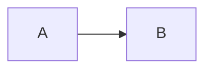
````

T-CM-074: Info string case and extras.

```JavaScript
const upper = "info string uppercase";
```

```js title="x.js" {1,3}
const a = 1;
const b = 2;
const c = 3;
```

T-CM-075: Empty fence and whitespace-only fence.

```
```

```

```

T-CM-076: Very long line (should scroll, not break layout).

```text
0123456789012345678901234567890123456789012345678901234567890123456789012345678901234567890123456789012345678901234567890123456789012345678901234567890123456789012345678901234567890123456789012345678901234567890123456789
```

### A9. Thematic breaks

T-CM-080: All of these are `<hr>`:

---
***
___
- - -
 *  *  *

### A10. HTML blocks and inline HTML

T-CM-090: Allowed-ish HTML. **EXPECT:** rendered or sanitized consistently, never executed.

<div align="center">
  <strong>Centered bold in div</strong><br>
  <em>emphasis</em> and <mark>mark</mark> and <abbr title="HyperText Markup Language">HTML</abbr>
</div>

T-CM-091: Markdown inside HTML needs a blank line.

<div>

**Markdown inside div (blank-line separated)**

</div>

<div>
**No blank line: should remain literal asterisks**
</div>

T-CM-092: Details/summary.

<details open>
<summary><b>Open by default</b></summary>

Nested content with a mermaid diagram:

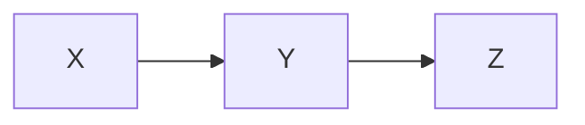

</details>

T-CM-093: Table in raw HTML.

<table>
  <tr><th>H1</th><th>H2</th></tr>
  <tr><td>a</td><td>b</td></tr>
</table>

---

## B. GFM Extensions

### B1. Tables

T-GF-001: Alignment and inline content.

| Left | Center | Right |
|:-----|:------:|------:|
| `code` | **bold** | [link](https://example.com) |
| ~~strike~~ | *italic* |  |
| long cell with many words to force wrapping behavior in narrow viewports | x | 123456789 |

T-GF-002: Ragged rows. **EXPECT:** missing cells empty, extra cells dropped (per GFM).

| A | B | C |
|---|---|---|
| 1 |
| 1 | 2 | 3 | 4 | 5 |

T-GF-003: Table without leading/trailing pipes.

A | B
--|--
1 | 2

T-GF-004: Escaped pipes and empty cells.

| a | b |
|---|---|
| \| | |
|   | x |

T-GF-005: Unicode and emoji in table.

| 言語 | العربية | Emoji |
|------|---------|-------|
| 日本語 | مرحبا | 👨‍👩‍👧‍👦 🏳️‍🌈 |

### B2. Strikethrough, task lists, footnotes

T-GF-010: ~~one tilde~~ and ~~~three tildes inline~~~ (spec: only 1 or 2 tildes).

T-GF-011: Footnotes: first[^1], second[^long], and a missing one[^missing].

[^1]: Simple footnote.
[^long]: Footnote with multiple blocks.

    Indented continuation paragraph.

    ```js
    console.log("code in footnote");
    ```

T-GF-012: Alerts (GitHub style). **EXPECT:** styled callouts, or plain blockquotes with the marker visible if unsupported.

> [!NOTE]
> Useful information.

> [!TIP]
> Helpful advice.

> [!IMPORTANT]
> Key information.

> [!WARNING]
> Urgent info.

> [!CAUTION]
> Negative consequences.

### B3. Math

T-GF-020: Inline $a^2 + b^2 = c^2$ and currency "$5 and $10" (should NOT become math if `$` pairs are ambiguous).

T-GF-021: Block math.

$$
\begin{aligned}
\nabla \cdot \mathbf{E} &= \frac{\rho}{\varepsilon_0} \\
\nabla \times \mathbf{B} &= \mu_0 \mathbf{J} + \mu_0 \varepsilon_0 \frac{\partial \mathbf{E}}{\partial t}
\end{aligned}
$$

T-GF-022: Invalid math. **EXPECT:** error shown inline, rest of page still renders: $\frac{1}{$

---

## C. Unicode and Text Handling

T-UN-001: CJK: 日本語のテキスト、中文文本、한국어 텍스트

T-UN-002: RTL: مرحبا بالعالم and עברית with mixed English text inline.

T-UN-003: Combining characters: é (e + U+0301), ñ, Z̷̧̛a̶l̴g̵o̸ (zalgo).

T-UN-004: Emoji ZWJ sequences: 👩‍💻 👨‍👩‍👧‍👦 🏳️‍⚧️ 🇮🇩 🇯🇵

T-UN-005: Zero-width characters (invisible): a​b‌c‍d (contains ZWSP, ZWNJ, ZWJ).

T-UN-006: Non-breaking and special spaces: a b c (NBSP, EN SPACE, EM SPACE).

T-UN-007: Heading with emoji and non-ASCII (anchor generation):

### 日本語 Heading 🚀 Ünïcödé

[Anchor to above](#日本語-heading--ünïcödé)

---

## D. Security Probes (benign canaries)

All probes only set a harmless `window.__xss_*` flag. After rendering, open the console and run
`Object.keys(window).filter(k => k.startsWith('__xss'))`. **EXPECT:** empty array.

T-SC-001: Script tag.

<script>window.__xss_script = 1</script>

T-SC-002: Image onerror.


T-SC-003: SVG onload.

<svg onload="window.__xss_svg = 1"><circle r="10"/></svg>

T-SC-004: Inline event handler on allowed tag.

<a href="#" onclick="window.__xss_onclick = 1">click me (should be inert)</a>

T-SC-005: `javascript:` URLs in links. **EXPECT:** href stripped or neutralized.

[js link](javascript:window.__xss_jslink=1)
[JS mixed case](JaVaScRiPt:window.__xss_jslink2=1)
[js with entity](&#106;avascript:window.__xss_jslink3=1)
[js with whitespace](java&#x09;script:window.__xss_jslink4=1)

T-SC-006: `data:` and `vbscript:` URLs.

[data html](data:text/html,<script>window.__xss_data=1</script>)


T-SC-007: iframe, object, embed, form, meta, base, link, style.

<iframe src="javascript:window.__xss_iframe=1"></iframe>
<iframe srcdoc="<script>parent.__xss_srcdoc=1</script>"></iframe>
<object data="javascript:window.__xss_object=1"></object>
<embed src="javascript:window.__xss_embed=1">
<form action="javascript:window.__xss_form=1"><button>submit</button></form>
<meta http-equiv="refresh" content="0;url=javascript:window.__xss_meta=1">
<base href="https://evil.example/">
<link rel="stylesheet" href="https://evil.example/x.css">
<style>body { background: red !important; }</style>

T-SC-008: CSS-based exfil / UI redress. **EXPECT:** `style` attribute stripped or restricted.

<div style="position:fixed;top:0;left:0;width:100vw;height:100vh;background:#f00;z-index:99999">OVERLAY</div>

T-SC-009: Mutation XSS style payloads.

<math><mtext><table><mglyph><style><!--</style>

<noscript><p title="</noscript>"></noscript>

T-SC-010: Markdown-in-attribute injection.

[x](https://example.com" onmouseover="window.__xss_attr=1)


T-SC-011: Autolink with quotes: <https://example.com/"onmouseover="window.__xss_auto=1>

T-SC-012: Link `target=_blank` safety. **EXPECT:** external links carry `rel="noopener noreferrer"`.

<a href="https://example.com" target="_blank">raw html target blank</a>

T-SC-013: File and app-scheme links. **EXPECT:** blocked or confirmed, never silently opened.

[file](file:///etc/passwd) [app](slack://open) [ms](ms-msdt:/id) [tel](tel:+620000000)

T-SC-014: Path traversal in image / link resolution (if the app loads local files).


---

## E. Mermaid: Advanced Syntax

### E1. Flowchart: markdown strings, shapes, styling, click handlers

T-MM-001: **EXPECT:** renders with bold/italic labels, varied shapes, custom link styles.

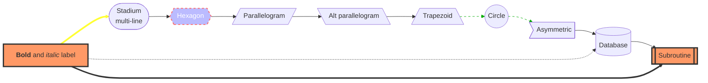

T-MM-002: Nested subgraphs with per-subgraph direction and cross-edges.

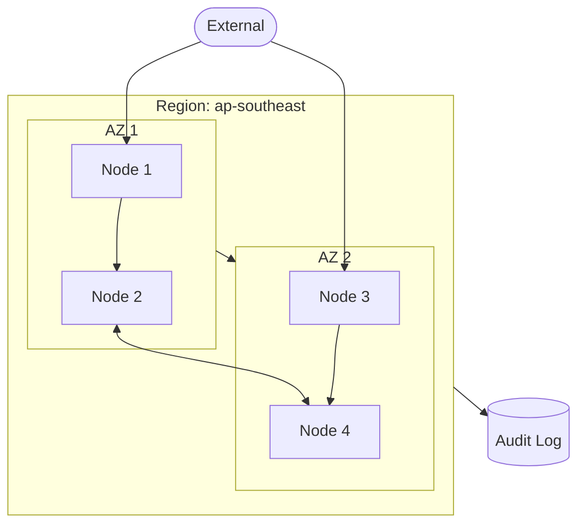

T-MM-003: Edge IDs, animations and new-style shapes (Mermaid 11.x). **EXPECT:** renders on 11.x; on older versions an error box, not a crash.

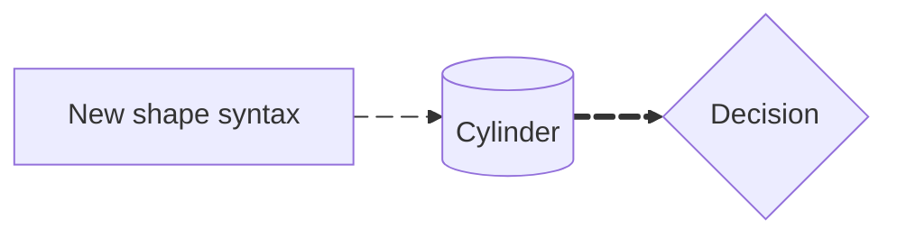

T-MM-004: Interaction callbacks. **EXPECT:** with `securityLevel: strict` clicks are disabled; no `window.__xss_click` flag.

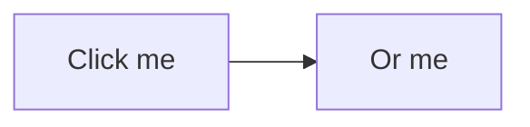

T-MM-005: HTML labels and injection attempt. **EXPECT:** tags escaped or sanitized, no `window.__xss_mermaid_label`.

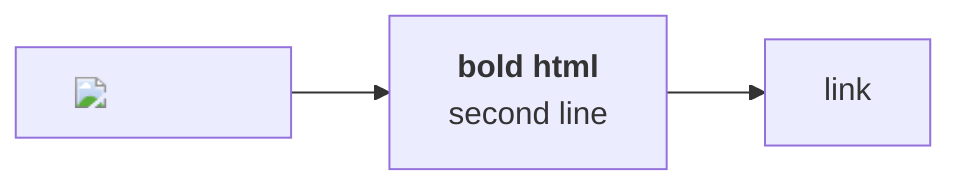

### E2. Sequence: every control structure

T-MM-010: **EXPECT:** all blocks render, autonumber continues through the end.

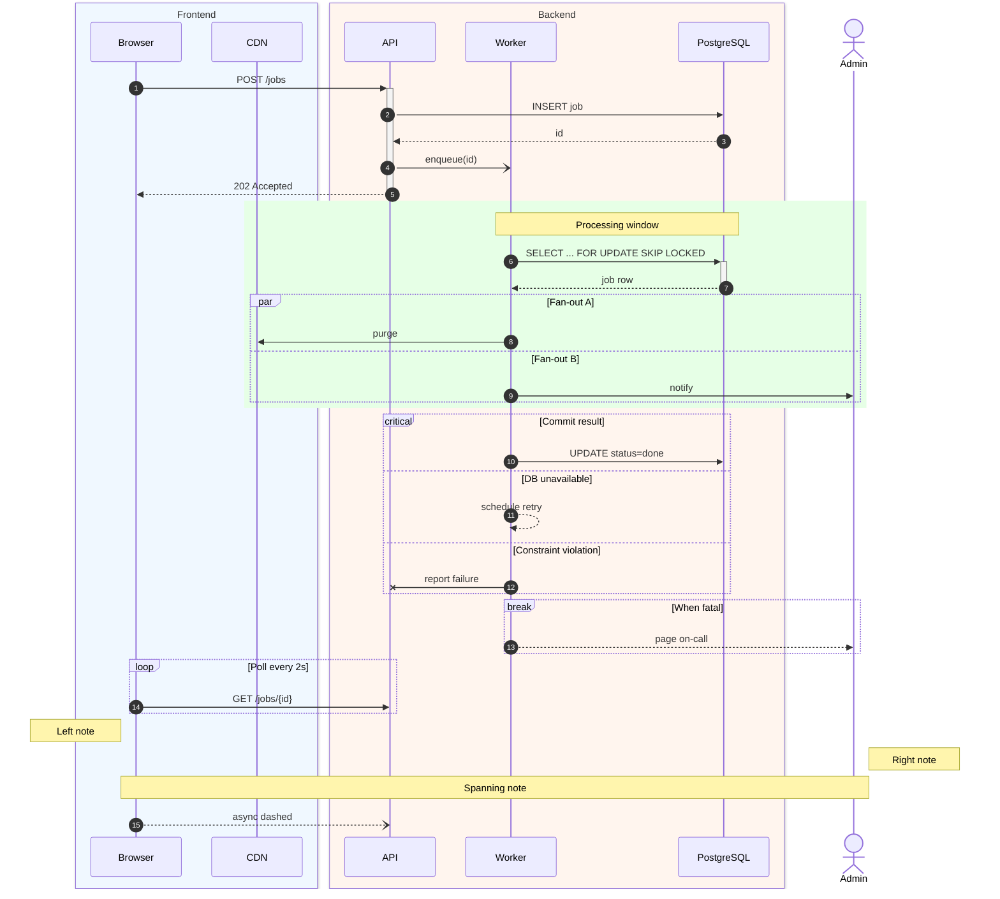

T-MM-011: Participant aliases with special characters and create/destroy.

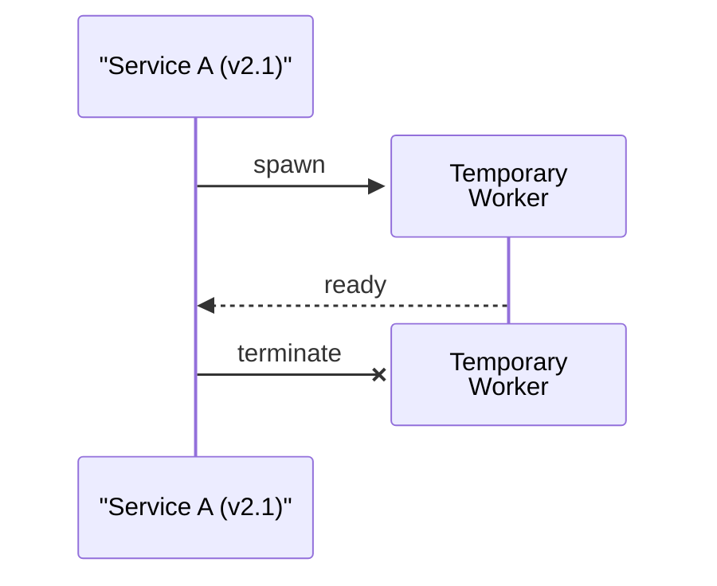

### E3. Class diagram: generics, namespaces, relationships

T-MM-020: **EXPECT:** generics shown with `<T>`, namespaces boxed, all relationship arrows distinct.

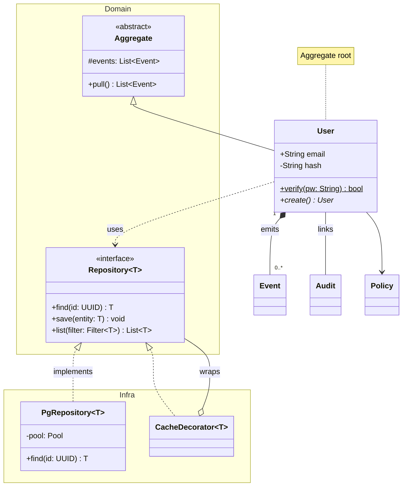

### E4. State: fork/join/choice/concurrency/notes

T-MM-030: **EXPECT:** fork and join bars, choice diamond, concurrent regions separated by a dashed line.

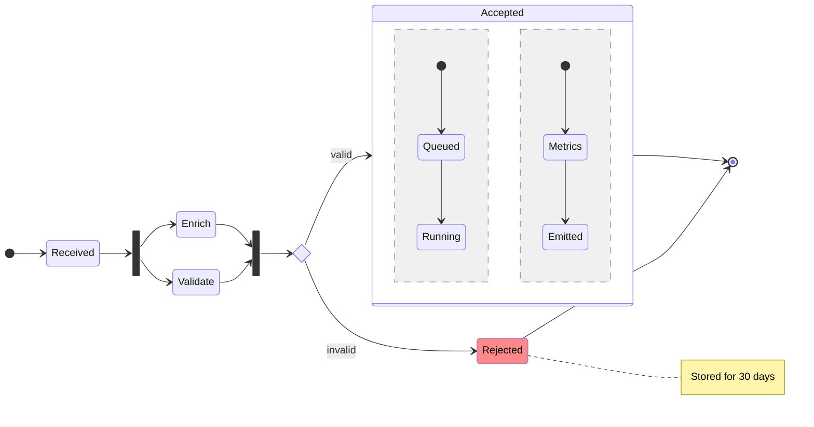

### E5. ER: all cardinalities, keys, comments

T-MM-040: **EXPECT:** every relationship notation is visually distinct.

```mermaid
erDiagram
    A ||--|| B : "one to one"
    A ||--o{ C : "one to zero-or-more"
    A ||--|{ D : "one to one-or-more"
    A }o--o{ E : "many to many"
    A |o--o| F : "zero-or-one both"
    A }|..|{ G : "non-identifying"

    A {
        uuid id PK "primary key"
        string name UK
        int age
        json meta "free-form"
    }
    C {
        uuid id PK
        uuid a_id FK
        timestamp created_at
    }
    "Table With Spaces" {
        string "weird col" PK
    }
```

### E6. Gantt: dependencies, milestones, vertical markers

T-MM-050: **EXPECT:** dependency chain respected, `crit` styled, milestone diamond, weekend exclusion.

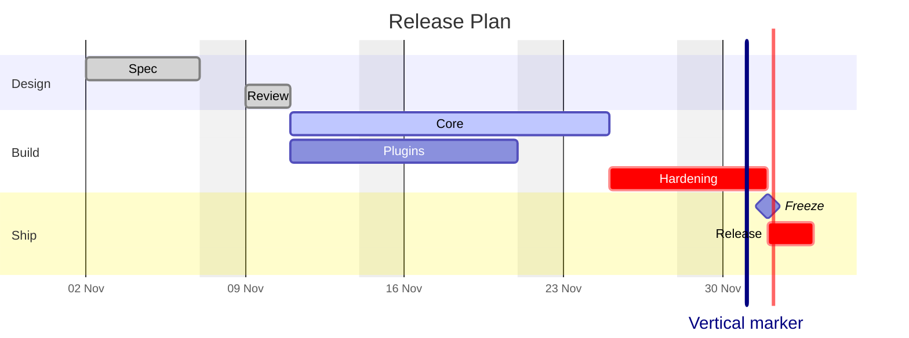

### E7. Newer diagram types (version-dependent)

T-MM-060: **EXPECT:** each renders on Mermaid 11.x. On older builds each shows a *contained* error and the rest of the page is unaffected.

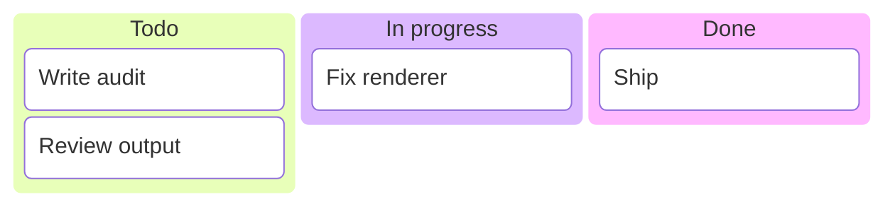

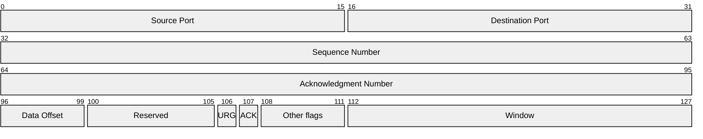

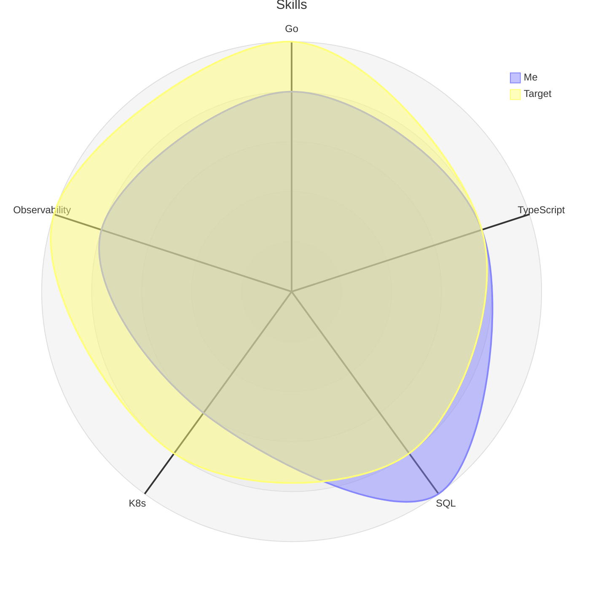

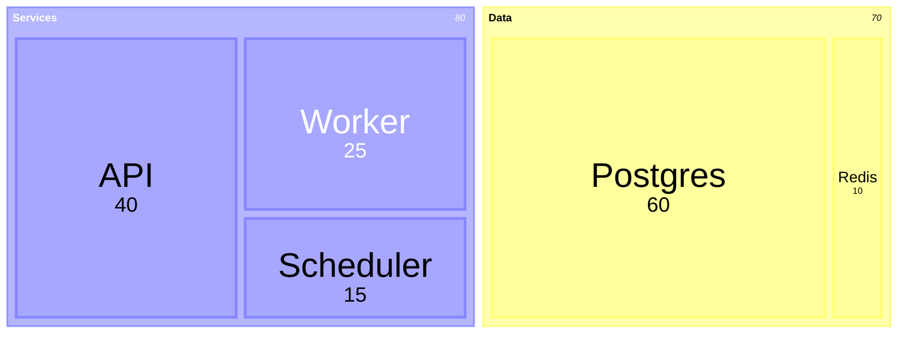

### E8. Config via frontmatter and init directives

T-MM-070: Frontmatter config. **EXPECT:** dark theme + step edges, title shown.

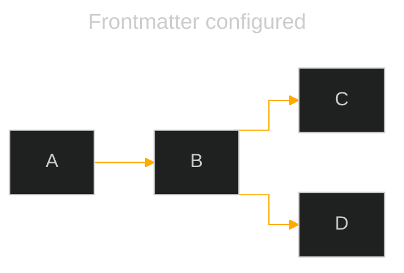

T-MM-071: Init directive with themeVariables. **EXPECT:** custom colors honoured (or ignored consistently if the app locks the theme).

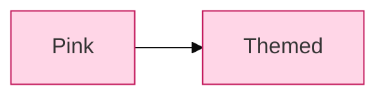

T-MM-072: Dangerous init directive. **EXPECT:** `securityLevel` override ignored; no `window.__xss_init` flag.

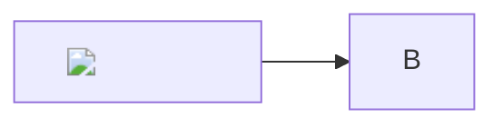

### E9. Placement: Mermaid in awkward containers

T-MM-080: Inside a list item.

1. First step

   ```mermaid
   flowchart LR
       L1 --> L2
   ```

2. Second step

T-MM-081: Inside a blockquote.

> ```mermaid
> flowchart LR
>     Q1 --> Q2
> ```

T-MM-082: Inside a table cell is impossible in Markdown. **EXPECT:** the fence is NOT rendered as a diagram here.

| Col |
|-----|
| ```mermaid flowchart LR A-->B ``` |

T-MM-083: Tilde-fenced Mermaid. **EXPECT:** treated the same as backtick fence.

~~~mermaid
flowchart LR
    T1 --> T2
~~~

T-MM-084: Info-string variants. **EXPECT:** documented behavior (render or not), consistent.

```Mermaid
flowchart LR
    Cap1 --> Cap2
```

```mermaid title="with attrs" {1}
flowchart LR
    Attr1 --> Attr2
```

```mmd
flowchart LR
    Alias1 --> Alias2
```

T-MM-085: Two diagrams back-to-back (ID collision check). **EXPECT:** both render, no style bleed.

```mermaid
flowchart LR
    S1[Same ids] --> S2
    classDef x fill:#f00
    class S1 x
```

```mermaid
flowchart LR
    S1[Same ids] --> S2
```

T-MM-086: Identical diagram repeated 3 times. **EXPECT:** 3 independent renders.

```mermaid
pie title Repeat
    "A" : 1
    "B" : 2
```

```mermaid
pie title Repeat
    "A" : 1
    "B" : 2
```

```mermaid
pie title Repeat
    "A" : 1
    "B" : 2
```

### E10. Mermaid error handling

T-MM-090: Syntax error. **EXPECT:** inline error box for this diagram only; document continues.

```mermaid
flowchart TD
    A --> B -->
    C[[ unclosed
```

T-MM-091: Unknown diagram type. **EXPECT:** error box.

```mermaid
notARealDiagram
    foo --> bar
```

T-MM-092: Empty diagram. **EXPECT:** handled gracefully.

```mermaid
```

T-MM-093: Huge label. **EXPECT:** wraps or truncates, no layout explosion.

```mermaid
flowchart LR
    A["Lorem ipsum dolor sit amet, consectetur adipiscing elit, sed do eiusmod tempor incididunt ut labore et dolore magna aliqua. Ut enim ad minim veniam, quis nostrud exercitation ullamco laboris nisi ut aliquip ex ea commodo consequat. Duis aute irure dolor in reprehenderit in voluptate velit esse cillum dolore eu fugiat nulla pariatur."] --> B
```

T-MM-094: Diagram after an error still renders. **EXPECT:** renders.

```mermaid
flowchart LR
    Recovery --> OK
```

T-MM-095: Theme switch. **EXPECT:** toggle light/dark in the app and confirm all diagrams re-render with the new theme (including after an error box).

---

## F. Result Sheet

| ID range | Area | PASS | FAIL | Notes |
|----------|------|:----:|:----:|-------|
| T-CM-001 to 008 | Headings / anchors | ☐ | ☐ | |
| T-CM-010 to 023 | Emphasis / code spans | ☐ | ☐ | |
| T-CM-030 to 038 | Links / images | ☐ | ☐ | |
| T-CM-040 to 044 | Breaks / escapes / entities | ☐ | ☐ | |
| T-CM-050 to 056 | Lists | ☐ | ☐ | |
| T-CM-060 to 061 | Blockquotes | ☐ | ☐ | |
| T-CM-070 to 076 | Code blocks | ☐ | ☐ | |
| T-CM-080 to 093 | HR / HTML | ☐ | ☐ | |
| T-GF-001 to 022 | GFM | ☐ | ☐ | |
| T-UN-001 to 007 | Unicode | ☐ | ☐ | |
| T-SC-001 to 014 | Security | ☐ | ☐ | |
| T-MM-001 to 005 | Flowchart | ☐ | ☐ | |
| T-MM-010 to 011 | Sequence | ☐ | ☐ | |
| T-MM-020 to 040 | Class / State / ER | ☐ | ☐ | |
| T-MM-050 to 060 | Gantt / newer types | ☐ | ☐ | |
| T-MM-070 to 072 | Config / init | ☐ | ☐ | |
| T-MM-080 to 095 | Placement / errors | ☐ | ☐ | |

*End of Part 1.*
