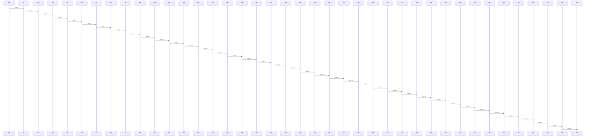

# Markdown Renderer Audit: Part 2 (Hostile and Malformed Input)

This file starts with a UTF-8 BOM and uses mixed line endings. **EXPECT:** the app never crashes, hangs, or corrupts
the rest of the page. Each section is independent; scroll to the end to confirm the final marker `END-OF-PART-2` appears.

---

## H1. Deep nesting
T-HO-001: 60-level blockquote. EXPECT: renders or caps depth gracefully.
> > > > > > > > > > > > > > > > > > > > > > > > > > > > > > > > > > > > > > > > > > > > > > > > > > > > > > > > > > > > deep quote

T-HO-002: 40-level nested list.
- level 1
  - level 2
    - level 3
      - level 4
        - level 5
          - level 6
            - level 7
              - level 8
                - level 9
                  - level 10
                    - level 11
                      - level 12
                        - level 13
                          - level 14
                            - level 15
                              - level 16
                                - level 17
                                  - level 18
                                    - level 19
                                      - level 20
                                        - level 21
                                          - level 22
                                            - level 23
                                              - level 24
                                                - level 25
                                                  - level 26
                                                    - level 27
                                                      - level 28
                                                        - level 29
                                                          - level 30
                                                            - level 31
                                                              - level 32
                                                                - level 33
                                                                  - level 34
                                                                    - level 35
                                                                      - level 36
                                                                        - level 37
                                                                          - level 38
                                                                            - level 39
                                                                              - level 40

T-HO-003: Deeply nested emphasis (regex backtracking check).

********************************************************************************************************************************************************************************************************text********************************************************************************************************************************************************************************************************

_a_a_a_a_a_a_a_a_a_a_a_a_a_a_a_a_a_a_a_a_a_a_a_a_a_a_a_a_a_a_a_a_a_a_a_a_a_a_a_a_a_a_a_a_a_a_a_a_a_a_a_a_a_a_a_a_a_a_a_a_a_a_a_a_a_a_a_a_a_a_a_a_a_a_a_a_a_a_a_a_a_a_a_a_a_a_a_a_a_a_a_a_a_a_a_a_a_a_a_a_a_a_a_a_a_a_a_a_a_a_a_a_a_a_a_a_a_a_a_a_a_a_a_a_a_a_a_a_a_a_a_a_a_a_a_a_a_a_a_a_a_a_a_a_a_a_a_a_a_a_a_a_a_a_a_a_a_a_a_a_a_a_a_a_a_a_a_a_a_a_a_a_a_a_a_a_a_a_a_a_a_a_a_a_a_a_a_a_a_a_a_a_a_a_a_a_a_a_a_a_a_a_a_a_a_a_a_a_a_a_a_a_a_a_a_a_a_a_a_a_a_a_a_a_a_a_a_a_a_a_a_a_a_a_a_a_a_a_a_a_a_a_a_a_a_a_a_a_a_a_a_a_a_a_a_a_a_a_a_a_a_a_a_a_a_a_a_a_a_a_a_a_a_a_a_a_a_a_a_a_a_a_a_a_a_a_a_a_a_a_a_a_a_a_a_a_a_a_a_a_a_a_a_a_a_a_a_a_a_a_a_a_a_a_a_a_a_a_a_a_a_a_a_a_a_a_a_a_a_a_a_a_a_a_a_a_a_a_a_a_a_a_a_a_a_a_a_a_a_a_a_a_a_a_a_a_a_a_a_a_a_a_a_a_a_a_a_a_a_a_a_a_a_a_a_a_a_a_a_a_a_a_a_a_a_a_a_a_a_a_a_a_a_a_a_a_a_a_a_a_a_a_a_a_a_a_a_a_a_a_a_a_a_a_a_a_a_a_a_a_a_a_a_a_a_a_a_a_a_a_a_a_a_a_a_a_a_a_a_a_a_a_a_a_a_a_a_a_a_a_a_a_a_a_a_a_a_a_a_a_a_a_a_a_a_a_a_a_a_a_a_a_a_a_a_a_a_a_a_a_a_a_a_a_a_a_a_a_a_a_a_a_a_a_a_a_a_a_a_a

[[[[[[[[[[[[[[[[[[[[[[[[[[[[[[[[[[[[[[[[[[[[[[[[[[[[[[[[[[[[[[[[[[[[[[[[[[[[[[[[[[[[[[[[[[[[[[[[[[[[[[[[[[[[[[[[[[[[[[[[[[[[[[[[[[[[[[[[[[[[[[[[[[[[[[[[[[[[[[[[[[[[[[[[[[[[[[[[[[[[[[[[[[[[[[[[[[[[[[[[[[[[[[[[[[[[[[[[[[[[[[[[[[[[[[[[[[[[[[[[[[[[[[[[[[[[[[[[[[[[[[[[[[[[[[[[[[[[[[[[[[[[[[[[[[[[[[[[[[[[x]]]]]]]]]]]]]]]]]]]]]]]]]]]]]]]]]]]]]]]]]]]]]]]]]]]]]]]]]]]]]]]]]]]]]]]]]]]]]]]]]]]]]]]]]]]]]]]]]]]]]]]]]]]]]]]]]]]]]]]]]]]]]]]]]]]]]]]]]]]]]]]]]]]]]]]]]]]]]]]]]]]]]]]]]]]]]]]]]]]]]]]]]]]]]]]]]]]]]]]]]]]]]]]]]]]]]]]]]]]]]]]]]]]]]]]]]]]]]]]]]]]]]]]]]]]]]]]]]]]]]]]]]]]]]]]]]]]]]]]]]]]]]]]]]]]]]]]]]]]]


```````````````````````````````````````````````````````````````````````````````````````````````````` x ```````````````````````````````````````````````````````````````````````````````````````````````````

<<<<<<<<<<<<<<<<<<<<<<<<<<<<<<<<<<<<<<<<<<<<<<<<<<<<<<<<<<<<<<<<<<<<<<<<<<<<<<<<<<<<<<<<<<<<<<<<<<<<<<<<<<<<<<<<<<<<<<<<<<<<<<<<<<<<<<<<<<<<<<<<<<<<<<<<<<<<<<<<<<<<<<<<<<<<<<<<<<<<<<<<<<<<<<<<<<<<<<<<<<<<<<<<<<<<<<<<<<<<<<<<<<<<<<<<<<<<<<<<<<<<<<<<<<<<<<<<<<<<<<<<<<<<<<<<<<<<<<<<<<<<<<<<<<<<<<<<<<<<

T-HO-004: ReDoS probes. EXPECT: each returns instantly.

aaaaaaaaaaaaaaaaaaaaaaaaaaaaaaaaaaaaaaaaaaaaaaaaaaaaaaaaaaaaaaaaaaaaaaaaaaaaaaaaaaaaaaaaaaaaaaaaaaaaaaaaaaaaaaaaaaaaaaaaaaaaaaaaaaaaaaaaaaaaaaaaaaaaaaaaaaaaaaaaaaaaaaaaaaaaaaaaaaaaaaaaaaaaaaaaaaaaaaaaaaaaaaaaaaaaaaaaaaaaaaaaaaaaaaaaaaaaaaaaaaaaaaaaaaaaaaaaaaaaaaaaaaaaaaaaaaaaaaaaaaaaaaaaaaaaaaaaaaaaaaaaaaaaaaaaaaaaaaaaaaaaaaaaaaaaaaaaaaaaaaaaaaaaaaaaaaaaaaaaaaaaaaaaaaaaaaaaaaaaaaaaaaaaaaaaaaaaaaaaaaaaaaaaaaaaaaaaaaaaaaaaaaaaaaaaaaaaaaaaaaaaaaaaaaaaaaaaaaaaaaaaaaaaaaaaaaaaaaaaaaaaaaaaaaaaaaaaaaaaaaaaaaaaaaaaaaaaaaaaaaaaaaaaaaaaaaaaaaaaaaaaaaaaaaaaaaaaaaaaaaaaaaaaaaaaaaaaaaaaaaaaaaaaaaaaaaaaaaaaaaaaaaaaaaaaaaaaaaaaaaaaaaaaaaaaaaaaaaaaaaaaaaaaaaaaaaaaaaaaaaaaaaaaaaaaaaaaaaaaaaaaaaaaaaaaaaaaaaaaaaaaaaaaaaaaaaaaaaaaaaaaaaaaaaaaaaaaaaaaaaaaaaaaaaaaaaaaaaaaaaaaaaaaaaaaaaaaaaaaaaaaaaaaaaaaaaaaaaaaaaaaaaaaaaaaaaaaaaaaaaaaaaaaaaaaaaaaaaaaaaaaaaaaaaaaaaaaaaaaaaaaaaaaaaaaaaaaaaaaaaaaaaaaaaaaaaaaaaaaaaaaaaaaaaaaaaaaaaaaaaaaaaaaaaaaaaaaaaaaaaaaaaaaaaaaaaaaaaaaaaaaaaaaaaaaaaaaaaaaaaaaaaaaaaaaaaaaaaaaaaaaaaaaaaaaaaaaaaaaaaaaaaaaaaaaaaaaaaaaaaaaaaaaaaaaaaaaaaaaaaaaaaaaaaaaaaaaaaaaaaaaaaaaaaaaaaaaaaaaaaaaaaaaaaaaaaaaaaaaaaaaaaaaaaaaaaaaaaaaaaaaaaaaaaaaaaaaaaaaaaaaaaaaaaaaaaaaaaaaaaaaaaaaaaaaaaaaaaaaaaaaaaaaaaaaaaaaaaaaaaaaaaaaaaaaaaaaaaaaaaaaaaaaaaaaaaaaaaaaaaaaaaaaaaaaaaaaaaaaaaaaaaaaaaaaaaaaaaaaaaaaaaaaaaaaaaaaaaaaaaaaaaaaaaaaaaaaaaaaaaaaaaaaaaaaaaaaaaaaaaaaaaaaaaaaaaaaaaaaaaaaaaaaaaaaaaaaaaaaaaaaaaaaaaaaaaaaaaaaaaaaaaaaaaaaaaaaaaaaaaaaaaaaaaaaaaaaaaaaaaaaaaaaaaaaaaaaaaaaaaaaaaaaaaaaaaaaaaaaaaaaaaaaaaaaaaaaaaaaaaaaaaaaaaaaaaaaaaaaaaaaaaaaaaaaaaaaaaaaaaaaaaaaaaaaaaaaaaaaaaaaaaaaaaaaaaaaaaaaaaaaaaaaaaaaaaaaaaaaaaaaaaaaaaaaaaaaaaaaaaaaaaaaaaaaaaaaaaaaaaaaaaaaaaaaaaaaaaaaaaaaaaaaaaaaaaaaaaaaaaaaaaaaaaaaaaaaaaaaaaaaaaaaaaaaaaaaaaaaaaaaaaaaaaaaaaaaaaaaaaaaaaaaaaaaaaaaaaaaaaaaaaaaaaaaaaaaaaaaaaaaaaaaaaaaaaaaaaaaaaaaaaaaaaaaaaaaaaaaaaaaaaaaaaaaaaaaaaaaaaaaaaaaaaaaaaaaaaaaaaaaaaaaaaaaaaaaaaaaaaaaaaaaaaaaaaaaaaaaaaaaaaaaaaaaaaaaaaaaaaaaaaaaaaaaaaaaaaaaaaaaaaaaaaaaaaaaaaaaaaaaaaaaaaaaaaaaaaaaaaaaaaaaaaaaaaaaaaaaaaaaaaaaaaaaaaaaaaaaaaaaaaaaaaaaaaaaaaaaaaaaaaaaaaaaaaaaaaaaaaaaaaaaaaaaaaaaaaaaaaaaaaaaaaaaaaaaaaaaaaaaaaaaaaaaaaaaaaaaaaaaaaaaaaaaaaaaaaaaaaaaaaaaaaaaaaaaaaaaaaaaaaaaaaaaaaaaaaaaaaaaaaaaaaaaaaaaaaaaaaaaaaaaaaaaaaaaaaaaaaaaaaaaaaaaaaaaaaaaaaaaaaaaaaaaaaaaaaaaaaaaaaaaaaaaaaaaaaaaaaaaaaaaaaaaaaaaaaaaaaaaaaaaaaaaaaaaaaaaaaaaaaaaaaaaaaaaaaaaaaaaaaaaaaaaaaaaaaaaaaaaaaaaaaaaaaaaaaaaaaaaaaaaaaaaaaaaaaaaaaaaaaaaaaaaaaaaaaaaaaaaaaaaaaaaaaaaaaaaaaaaaaaaaaaaaaaaaaaaaaaaaaaaaaaaaaaaaaaaaaaaaaaaaaaaaaaaaaaaaaaaaaaaaaaaaaaaaaaaaaaaaaaaaaaaaaaaaaaaaaaaaaaaaaaaaaaaaaaaaaaaaaaaaaaaaaaaaaaaaaaaaaaaaaaaaaaaaaaaaaaaaaaaaaaaaaaaaaaaaaaaaaaaaaaaaaaaaaaaaaaaaaaaaaaaaaaaaaaaaaaaaaaaaaaaaaaaaaaaaaaaaaaaaaaaaaaaaaaaaaaaaaaaaaaaaaaaaaaaaaaaaaaaaaaaaaaaaaaaaaaaaaaaaaaaaaaaaaaaaaaaaaaaaaaaaaaaaaaaaaaaaaaaaaaaaaaaaaaaaaaaaaaaaaaaaaaaaaaaaaaaaaaaaaaaaaaaaaaaaaaaaaaaaaaaaaaaaaaaaaaaaaaaaaaaaaaaaaaaaaaaaaaaaaaaaaaaaaaaaaaaaaaaaaaaaaaaaaaaaaaaaaaaaaaaaaaaaaaaaaaaaaaaaaaaaaaaaaaaaaaaaaaaaaaaaaaaaaaaaaaaaaaaaaaaaaaaaaaaaaaaaaaaaaaaaaaaaaaaaaaaaaaaaaaaaaaaaaaaaaaaaaaaaaaaaaaaaaaaaaaaaaaaaaaaaaaaaaaaaaaaaaaaaaaaaaaaaaaaaaaaaaaaaaaaaaaaaaaaaaaaaaaaaaaaaaaaaaaaaaaaaaaaaaaaaaaaaaaaaaaaaaaaaaaaaaaaaaaaaaaaaaaaaaaaaaaaaaaaaaaaaaaaaaaaaaaaaaaaaaaaaaaaaaaaaaaaaaaaaaaaaaaaaaaaaaaaaaaaaaaaaaaaaaaaaaaaaaaaaaaaaaaaaaaaaaaaaaaaaaaaaaaaaaaaaaaaaaaaaaaaaaaaaaaaaaaaaaaaaaaaaaaaaaaaaaaaaaaaaaaaaaaaaaaaaaaaaaaaaaaaaaaaaaaaaaaaaaaaaaaaaaaaaaaaaaaaaaaaaaaaaaaaaaaaaaaaaaaaaaaaaaaaaaaaaaaaaaaaaaaaaaaaaaaaaaaaaaaaaaaaaaaaaaaaaaaaaaaaaaaaaaaaaaaaaaaaaaaaaaaaaaaaaaaaaaaaaaaaaaaaaaaaaaaaaaaaaaaaaaaaaaaaaaaaaaaaaaaaaaaaaaaaaaaaaaaaaaaaaaaaaaaaaaaaaaaaaaaaaaaaaaaaaaaaaaaaaaaaaaaaaaaaaaaaaaaaaaaaaaaaaaaaaaaaaaaaaaaaaaaaaaaaaaaaaaaaaaaaaaaaaaaaaaaaaaaaaaaaaaaaaaaaaaaaaaaaaaaaaaaaaaaaaaaaaaaaaaaaaaaaaaaaaaaaaaaaaaaaaaaaaaaaaaaaaaaaaaaaaaaaaaaaaaaaaaaaaaaaaaaaaaaaaaaaaaaaaaaaaaaaaaaaaaaaaaaaaaaaaaaaaaaaaaaaaaaaaaaaaaaaaaaaaaaaaaaaaaaaaaaaaaaaaaaaaaaaaaaaaaaaaaaaaaaaaaaaaaaaaaaaaaaaaaaaaaaaaaaaaaaaaaaaaaaaaaaaaaaaaaaaaaaaaaaaaaaaaaaaaaaaaaaaaaaaaaaaaaaaaaaaaaaaaaaaaaaaaaaaaaaaaaaaaaaaaaaaaaaaaaaaaaaaaaaaaaaaaaaaaaaaaaaaaaaaaaaaaaaaaaaaaaaaaaaaaaaaaaaaaaaaaaaaaaaaaaaaaaaaaaaaaaaaaaaaaaaaaaaaaaaaaaaaaaaaaaaaaaaaaaaaaaaaaaaaaaaaaaaaaaaaaaaaaaaaaaaaaaaaaaaaaaaaaaaaaaaaaaaaaaaaaaaaaaaaaaaaaaaaaaaaaaaaaaaaaaaaaaaaaaaaaaaaaaaaaaaaaaaaaaaaaaaaaaaaaaaaaaaaaaaaaaaaaaaaaaaaaaaaaaaaaaaaaaaaaaaaaaaaaaaaaaaaaaaaaaaaaaaaaaaaaaaaaaaaaaaaaaaaaaaaaaaaaaaaaaaaaaaaaaaaaaaaaaaaaaaaaaaaaaaaaaaaaaaaaaaaaaaaaaaaaaaaaaaaaaaaaaaaaaaaaaaaaaaaaaaaaaaaaaaaaaaaaaaaaaaaaaaaaaaaaaaaaaaaaaaaaaaaaaaaaaaaaaaaaaaaaaaaaaaaaaaaaaaaaaaaaaaaaaaaaaaaaaaaaaaaaaaaaaaaaaaaaaaaaaaaaaaaaaaaaaaaaaaaaaaaaaaaaaaaaaaaaaaaaaaaaaaaaaaaaaaaaaaaaaaaaaaaaaaaaaaaaaaaaaaaaaaaaaaaaaaaaaaaaaaaaaaaaaaaaaaaaaaaaaaaaaaaaaaaaaaaaaaaaaaaaaaaaaaaaaaaaaaaaaaaaaaaaaaaaaaaaaaaaaaaaaaaaaaaaaaaaaaaaaaaaaaaaaaaaaaaaaaaaaaaaaaaaaaaaaaaaaaaaaaaaaaaaaaaaaaaaaaaaaaaaaaaaaaaaaaaaaaaaaaaaaaaaaaaaaaaaaaaaaaaaaaaaaaaaaaaaaaaaaaaaaaaaaaaaaaaaaaaaaaaaaaaaaaaaaaaaaaaaaaaaaaa!

- - - - - - - - - - - - - - - - - - - - - - - - - - - - - - - - - - - - - - - - - - - - - - - - - - - - - - - - - - - - - - - - - - - - - - - - - - - - - - - - - - - - - - - - - - - - - - - - - - - - - - - - - - - - - - - - - - - - - - - - - - - - - - - - - - - - - - - - - - - - - - - - - - - - - - - - - - - - - - - - - - - - - - - - - - - - - - - - - - - - - - - - - - - - - - - - - - - - - - - - - - - - - - - - - - - - - - - - - - - - - - - - - - - - - - - - - - - - - - - - - - - - - - - - - - - - - - - - - - - - - - - - - - - - - - - - - - - - - - - - - - - - - - - - - - - - - - - - - - - - - - - - - - - - - - - - - - - - - - - - - - - - - - - - - - - - - - - - - - - - - - - - - - - - - - - - - - - - - - - - - - - - - - - - - - - - - - - - - - - - - - - - - - - - - - - - - - - - - - - - - - - - - - - - - - - - - - - - - - - - - - - - - - - - - - - - - - - - - - - - - - - - - - - - - - - - - - - - - - - - - - - - - - - - - - - - - - - - - - - - - - - - - - - - - - - - - - - - - - - - - - - - - - - - - - - - - - - - - - - - - - - - - - - - - - - - - - - - - - - - - - - - - - - - - - - - - - - - - - - - - - - - - - - - - - - - - - - - - - - - - - - - - - - - - - - - - - - - - - - - - - - - - - - - - - - - - - - - - - - - - - - - - - - - - - - - - - - - - - - - - - - - - - - - - - - - - - - - - - - - - - - - - - - - - - - - - - - - - - - - - - - - - - - - - - - - - - - - - - - - - - - - - - - - - - - - - - - - - - - - - - - - - - - - - - - - - - - - - - - - - - - - - - - - - - - - - - - - - - - - - - - - - - - - - - - - - - - - - - - - - - - - - - - - - - - - - - - - - - - - - - - - - - - - - - - - - - - - - - - - - - - - - - - - - - - - - - - - - - - - - - - - - - - - - - - - - - - - - - - - - - - - - - - - - - - - - - - - - - - - - - - - - - - - - - - - - - - - - - - - - - - - - - - - - - - - - - - - - - - - - - - - - - - - - - - - - - - - - - - - - - - - - - - - - - - - - - - - - - - - - - - - - - - - - - - - - - - - - - - - - - - - - - - - - - - - - - - - - - - - - - - - - - - - - - - - - - - - - - - - - - - - - - - - - - - - - - - - - - - - - - - - - - - - - - - - - - - - - - - - - - - - - - - - - - - - - - - - - - - - - - - - - - - - - - - - - - - - - - - - - - - - - - - - - - - - - - - - - - - - - - - - - - - - - - - - - - - - - - - - - - - - - - - - - - - - - - - - - - - - - - - - - - - - - - - - - - - - - - - - - - - - - - - - - - - - - - - - - - - - - - - - - - - - - - - - - - - - - - - - - - - - - - - - - - - - - - - - - - - - - - - - - - - - - - - - - - - - - - - - - - - - - - - - - - - - - - - - - - - - - - - - - - - - - - - - - - - - - - - - - - - - - - - - - - - - - - - - - - - - - - - - - - - - - - - - - - - - - - - - - - - - - - - - - - - - - - - - - - - - - - - - - - - - - - - - - - - - - - - - - - - - - - - - - - - - - - - - - - - - - - - - - - - - - - - - - - - - - - - - - - - - - - - - - - - - - - - - - - - - - - - - - - - - - - - - - - - - - - - - - - - - - - - - - - - - - - - - - - - - - - - - - - - - - - - - - - - - - - - - - - - - - - - - - - - - - - - - - - - - - - - - - - - - - - - - - - - - - - - - - - - - - - - - - - - - - - - - - - - - - - - - - - - - - - - - - - - - - - - - - - - - - - - - - - - - - - - - - - - - - - - - - - - - - - - - - - - - - - - - - - - - - - - - - - - - - - - - - - - - - - - - - - - - - - - - - - - - - - - - - - - - - - - - - - - - - - - - - - - - - - - - - - - - - - - - - - - - - - - - - - - - - - - - - - - - - - - - - - - - - - - - - - - - - - - - - - - - - - - - - - - - - - - - - - - - - - - - - - - - - - - - - - - - - - - - - - - - - - - - - - - - - - - - - - - - - - - - - - - - - - - - - - - - - - - - - - - - - - - - - - - - - - - - - - - - - - - - - - - - - - - - - - - - - - - - - - - - - - - - - - - - - - - - - - - - - - - - - - - - - - - - - - - - - - - - - - - - - - - - - - - - - - - - - - - - - - - - - - - - - - - - - - - - - - - - - - - - - - - - - - - - - - - - - - - - - - - - - - - - - - - - - - - - - - - - - - - - - - - - - - - - - - - - - - - - - - - - - - - - 

| a | a | a | a | a | a | a | a | a | a | a | a | a | a | a | a | a | a | a | a | a | a | a | a | a | a | a | a | a | a | a | a | a | a | a | a | a | a | a | a | a | a | a | a | a | a | a | a | a | a | a | a | a | a | a | a | a | a | a | a | a | a | a | a | a | a | a | a | a | a | a | a | a | a | a | a | a | a | a | a | a | a | a | a | a | a | a | a | a | a | a | a | a | a | a | a | a | a | a | a | a | a | a | a | a | a | a | a | a | a | a | a | a | a | a | a | a | a | a | a | a | a | a | a | a | a | a | a | a | a | a | a | a | a | a | a | a | a | a | a | a | a | a | a | a | a | a | a | a | a | a | a | a | a | a | a | a | a | a | a | a | a | a | a | a | a | a | a | a | a | a | a | a | a | a | a | a | a | a | a | a | a | a | a | a | a | a | a | a | a | a | a | a | a | a | a | a | a | a | a | a | a | a | a | a | a | a | a | a | a | a | a | a | a | a | a | a | a | a | a | a | a | a | a | a | a | a | a | a | a | a | a | a | a | a | a | a | a | a | a | a | a | a | a | a | a | a | a | a | a | a | a | a | a | a | a | a | a | a | a | a | a | a | a | a | a | a | a | a | a | a | a | a | a | a | a | a | a | a | a | a | a | a | a | a | a | a | a | a | a | a | a | a | a | a | a | a | a | a | a | a | a | a | a | a | a | a | a | a | a | a | a | a | a | a | a | a | a | a | a | a | a | a | a | a | a | a | a | a | a | a | a | a | a | a | a | a | a | a | a | a | a | a | a | a | a | a | a | a | a | a | a | a | a | a | a | a | a | a | a | a | a | a | a | a | a | a | a | a | a | a | a | a | a | a | a | a | a | a | a | a | a | a | a | a | a | a | a | a | a | a | a | a | a | a | a | a | a | a | a | a | a | a | a | a | a | a | a | a | a | a | a | a | a | a | a | a | a | a | a | a | a | a | a | a | a | a | a | a | a | a | a | a | a | a | a | a | a | a | a | a | a | a | a | a | a | a | a | a | a | a | a | a | a | a | a | a | a | a | a | a | a | a | a | a | a | a | a | a | a | a | a | a | a | a | a | a | a | a | a | a | a | a | a | a | a | a | a | a | a | a | a | a | a | a | a | a | a | a | a |
|---|---|---|---|---|---|---|---|---|---|---|---|---|---|---|---|---|---|---|---|---|---|---|---|---|---|---|---|---|---|---|---|---|---|---|---|---|---|---|---|---|---|---|---|---|---|---|---|---|---|---|---|---|---|---|---|---|---|---|---|---|---|---|---|---|---|---|---|---|---|---|---|---|---|---|---|---|---|---|---|---|---|---|---|---|---|---|---|---|---|---|---|---|---|---|---|---|---|---|---|---|---|---|---|---|---|---|---|---|---|---|---|---|---|---|---|---|---|---|---|---|---|---|---|---|---|---|---|---|---|---|---|---|---|---|---|---|---|---|---|---|---|---|---|---|---|---|---|---|---|---|---|---|---|---|---|---|---|---|---|---|---|---|---|---|---|---|---|---|---|---|---|---|---|---|---|---|---|---|---|---|---|---|---|---|---|---|---|---|---|---|---|---|---|---|---|---|---|---|---|---|---|---|---|---|---|---|---|---|---|---|---|---|---|---|---|---|---|---|---|---|---|---|---|---|---|---|---|---|---|---|---|---|---|---|---|---|---|---|---|---|---|---|---|---|---|---|---|---|---|---|---|---|---|---|---|---|---|---|---|---|---|---|---|---|---|---|---|---|---|---|---|---|---|---|---|---|---|---|---|---|---|---|---|---|---|---|---|---|---|---|---|---|---|---|---|---|---|---|---|---|---|---|---|---|---|---|---|---|---|---|---|---|---|---|---|---|---|---|---|---|---|---|---|---|---|---|---|---|---|---|---|---|---|---|---|---|---|---|---|---|---|---|---|---|---|---|---|---|---|---|---|---|---|---|---|---|---|---|---|---|---|---|---|---|---|---|---|---|---|---|---|---|---|---|---|---|---|---|---|---|---|---|---|---|---|---|---|---|---|---|---|---|---|---|---|---|---|---|---|---|---|---|---|---|---|---|---|---|---|---|---|---|---|---|---|---|---|---|---|---|---|---|---|---|---|---|---|---|---|---|---|---|---|---|---|---|---|---|---|---|---|---|---|---|---|---|---|---|---|---|---|---|---|---|---|---|---|---|---|---|---|---|---|---|---|---|---|---|---|---|---|---|---|---|---|---|---|---|---|---|---|---|---|---|---|---|---|---|---|---|---|---|---|---|---|---|---|---|---|
| x | x | x | x | x | x | x | x | x | x | x | x | x | x | x | x | x | x | x | x | x | x | x | x | x | x | x | x | x | x | x | x | x | x | x | x | x | x | x | x | x | x | x | x | x | x | x | x | x | x | x | x | x | x | x | x | x | x | x | x | x | x | x | x | x | x | x | x | x | x | x | x | x | x | x | x | x | x | x | x | x | x | x | x | x | x | x | x | x | x | x | x | x | x | x | x | x | x | x | x | x | x | x | x | x | x | x | x | x | x | x | x | x | x | x | x | x | x | x | x | x | x | x | x | x | x | x | x | x | x | x | x | x | x | x | x | x | x | x | x | x | x | x | x | x | x | x | x | x | x | x | x | x | x | x | x | x | x | x | x | x | x | x | x | x | x | x | x | x | x | x | x | x | x | x | x | x | x | x | x | x | x | x | x | x | x | x | x | x | x | x | x | x | x | x | x | x | x | x | x | x | x | x | x | x | x | x | x | x | x | x | x | x | x | x | x | x | x | x | x | x | x | x | x | x | x | x | x | x | x | x | x | x | x | x | x | x | x | x | x | x | x | x | x | x | x | x | x | x | x | x | x | x | x | x | x | x | x | x | x | x | x | x | x | x | x | x | x | x | x | x | x | x | x | x | x | x | x | x | x | x | x | x | x | x | x | x | x | x | x | x | x | x | x | x | x | x | x | x | x | x | x | x | x | x | x | x | x | x | x | x | x | x | x | x | x | x | x | x | x | x | x | x | x | x | x | x | x | x | x | x | x | x | x | x | x | x | x | x | x | x | x | x | x | x | x | x | x | x | x | x | x | x | x | x | x | x | x | x | x | x | x | x | x | x | x | x | x | x | x | x | x | x | x | x | x | x | x | x | x | x | x | x | x | x | x | x | x | x | x | x | x | x | x | x | x | x | x | x | x | x | x | x | x | x | x | x | x | x | x | x | x | x | x | x | x | x | x | x | x | x | x | x | x | x | x | x | x | x | x | x | x | x | x | x | x | x | x | x | x | x | x | x | x | x | x | x | x | x | x | x | x | x | x | x | x | x | x | x | x | x | x | x | x | x | x | x | x | x | x | x | x | x | x | x | x | x | x | x | x | x | x | x | x | x | x | x | x | x | x | x | x | x | x | x | x | x | x | x | x |

[link](((((((((((((((((((((((((((((((((((((((((((((((((((((((((((((((((((((((((((((((((((((((((((((((((((((((((((((((((((((((((((((((((((((((((((((((((((((((((((((((((((((((((((((((((((((((((((((((((((((((((((((((((((((((((((((((((((((((((((((((((((((((((((((((((((((((((((((((((((((((((((((((((((((((((((((((((((((((((((((((((((((((((((((((((((((((((((((((((((((((((((((((((((((((((((((((((((((((((((((((((((((((((((((((((((((((((((((((((((((((((((((((((((((((((((((((((((((((((((((((((((((((((((((((((((((((((((((((((((((((((((((((((((((((((((((((((((((((((((((((((((((((((((((((((((((((((((((((((((((((((((((((((((((((((((((((((((((((((((((((((((((((((((((((((((((((((((((((((((((((((((((((((((((((((((((((((((((((((((((((((((((((((((((((((((((((((((((((((((((((((((((((((((((((((((((((((((((((((((((((((((((((((((((((((((((((((((((((((((((((((((((((((((((((((((((((((((((((((((((((((((((((((((((((((((((((((((((((((((((((((((((((((((((((((((((((((((((((((((((((((((((((((((((((((((((((((((((((((((((((((x)))))))))))))))))))))))))))))))))))))))))))))))))))))))))))))))))))))))))))))))))))))))))))))))))))))))))))))))))))))))))))))))))))))))))))))))))))))))))))))))))))))))))))))))))))))))))))))))))))))))))))))))))))))))))))))))))))))))))))))))))))))))))))))))))))))))))))))))))))))))))))))))))))))))))))))))))))))))))))))))))))))))))))))))))))))))))))))))))))))))))))))))))))))))))))))))))))))))))))))))))))))))))))))))))))))))))))))))))))))))))))))))))))))))))))))))))))))))))))))))))))))))))))))))))))))))))))))))))))))))))))))))))))))))))))))))))))))))))))))))))))))))))))))))))))))))))))))))))))))))))))))))))))))))))))))))))))))))))))))))))))))))))))))))))))))))))))))))))))))))))))))))))))))))))))))))))))))))))))))))))))))))))))))))))))))))))))))))))))))))))))))))))))))))))))))))))))))))))))))))))))))))))))))))))))))))))))))))))))))))))))))))))))))))))))))))))))))))))))))))))))))))))))))))))))))))))))))))))))))))))))))))))))))))))))))))))))))))))))))))))))))))))))))))))))))))))))))))))))))))))

<https://aaaaaaaaaaaaaaaaaaaaaaaaaaaaaaaaaaaaaaaaaaaaaaaaaaaaaaaaaaaaaaaaaaaaaaaaaaaaaaaaaaaaaaaaaaaaaaaaaaaaaaaaaaaaaaaaaaaaaaaaaaaaaaaaaaaaaaaaaaaaaaaaaaaaaaaaaaaaaaaaaaaaaaaaaaaaaaaaaaaaaaaaaaaaaaaaaaaaaaaaaaaaaaaaaaaaaaaaaaaaaaaaaaaaaaaaaaaaaaaaaaaaaaaaaaaaaaaaaaaaaaaaaaaaaaaaaaaaaaaaaaaaaaaaaaaaaaaaaaaaaaaaaaaaaaaaaaaaaaaaaaaaaaaaaaaaaaaaaaaaaaaaaaaaaaaaaaaaaaaaaaaaaaaaaaaaaaaaaaaaaaaaaaaaaaaaaaaaaaaaaaaaaaaaaaaaaaaaaaaaaaaaaaaaaaaaaaaaaaaaaaaaaaaaaaaaaaaaaaaaaaaaaaaaaaaaaaaaaaaaaaaaaaaaaaaaaaaaaaaaaaaaaaaaaaaaaaaaaaaaaaaaaaaaaaaaaaaaaaaaaaaaaaaaaaaaaaaaaaaaaaaaaaaaaaaaaaaaaaaaaaaaaaaaaaaaaaaaaaaaaaaaaaaaaaaaaaaaaaaaaaaaaaaaaaaaaaaaaaaaaaaaaaaaaaaaaaaaaaaaaaaaaaaaaaaaaaaaaaaaaaaaaaaaaaaaaaaaaaaaaaaaaaaaaaaaaaaaaaaaaaaaaaaaaaaaaaaaaaaaaaaaaaaaaaaaaaaaaaaaaaaaaaaaaaaaaaaaaaaaaaaaaaaaaaaaaaaaaaaaaaaaaaaaaaaaaaaaaaaaaaaaaaaaaaaaaaaaaaaaaaaaaaaaaaaaaaaaaaaaaaaaaaaaaaaaaaaaaaaaaaaaaaaaaaaaaaaaaaaaaaaaaaaaaaaaaaaaaaaaaaaaaaaaaaaaaaaaaaaaaaaaaaaaaaaaaaaaaaaaaaaaaaaaaaaaaaaaaaaaaaaaaaaaaaaaaaaaaaaaaaaaaaaaaaaaaaaaaaaaaaaaaaaaaaaaaaaaaaaaaaaaaaaaaaaaaaaaaaaaaaaaaaaaaaaaaaaaaaaaaaaaaaaaaaaaaaaaaaaaaaaaaaaaaaaaaaaaaaaaaaaaaaaaaaaaaaaaaaaaaaaaaaaaaaaaaaaaaaaaaaaaaaaaaaaaaaaaaaaaaaaaaaaaaaaaaaaaaaaaaaaaaaaaaaaaaaaaaaaaaaaaaaaaaaaaaaaaaaaaaaaaaaaaaaaaaaaaaaaaaaaaaaaaaaaaaaaaaaaaaaaaaaaaaaaaaaaaaaaaaaaaaaaaaaaaaaaaaaaaaaaaaaaaaaaaaaaaaaaaaaaaaaaaaaaaaaaaaaaaaaaaaaaaaaaaaaaaaaaaaaaaaaaaaaaaaaaaaaaaaaaaaaaaaaaaaaaaaaaaaaaaaaaaaaaaaaaaaaaaaaaaaaaaaaaaaaaaaaaaaaaaaaaaaaaaaaaaaaaaaaaaaaaaaaaaaaaaaaaaaaaaaaaaaaaaaaaaaaaaaaaaaaaaaaaaaaaaaaaaaaaaaaaaaaaaaaaaaaaaaaaaaaaaaaaaaaaaaaaaaaaaaaaaaaaaaaaaaaaaaaaaaaaaaaaaaaaaaaaaaaaaaaaaaaaaaaaaaaaaaaaaaaaaaaaaaaaaaaaaaaaaaaaaaaaaaaaaaaaaaaaaaaaaaaaaaaaaaaaaaaaaaaaaaaaaaaaaaaaaaaaaaaaaaaaaaaaaaaaaaaaaaaaaaaaaaaaaaaaaaaaaaaaaaaaaaaaaaaaaaaaaaaaaaaaaaaaaaaaaaaaaaaaaaaaaaaaaaaaaaaaaaaaaaaaaaaaaaaaaaaaaaaaaaaaaaaaaaaaaaaaaaaaaaaaaaaaaaaaaaaaaaaaaaaaaaaaaaaaaaaaaaaaaaaaaaaaaaaaaaaaaaaaaaaaaaaaaaaaaaaaaaaaaaaaaaaaaaaaaaaaaaaaaaaaaaaaaaaaaaaaaaaaaaaaaaaaaaaaaaaaaaaaaaaaaaaaaaaaaaaaaaaaaaaaaaaaaaaaaaaaaaaaaaaaaaaaaaaaaaaaaaaaaaaaaaaaaaaaaaaaaaaaaaaaaaaaaaaaaaaaaaaaaaaaaaaaaaaaaaaaaaaaaaaaaaaaaaaaaaaaaaaaaaaaaaaaaaaaaaaaaaaaaaaaaaaaaaaaaaaaaaaaaaaaaaaaaaaaaaaaaaaaaaaaaaaaaaaaaaaaaaaaaaaaaaaaaaaaaaaaaaaaaaaaaaaaaaaaaaaaaaaaaaaaaaaaaaaaaaaaaaaaaaaaaaaaaaaaaaaaaaaaaaaaaaaaaaaaaaaaaaaaaaaaaaaaaaaaaaaaaaaaaaaaaaaaaaaaaaaaaaaaaaaaaaaaaaaaaaaaaaaaaaaaaaaaaaaaaaaaaaaaaaaaaaaaaaaaaaaaaaaaaaaaaaaaaaaaaaaaaaaaaaaaaaaaaaaaaaaaaaaaaaaaaaaaaaaaaaaaaaaaaaaaaaaaaaaaaaaaaaaaaaaaaaaaaaaaaaaaaaaaaaaaaaaaaaaaaaaaaaaaaaaaaaaaaaaaaaaaaaaaaaaaaaaaaaaaaaaaaaaaaaaaaaaaaaaaaaaaaaaaaaaaaaaaaaaaaaaaaaaaaaaaaaaaaaaaaaaaaaaaaaaaaaaaaaaaaaaaaaaaaaaaaaaaaaaaaaaaaaaaaaaaaaaaaaaaaaaaaaaaaaaaaaaaaaaaaaaaaaaaaaaaaaaaaaaaaaaaaaaaaaaaaaaaaaaaaaaaaaaaaaaaaaaaaaaaaaaaaaaaaaaaaaaaaaaaaaaaaaaaaaaaaaaaaaaaaaaaaaaaaaaaaaaaaaaaaaaaaaaaaaaaaaaaaaaaaaaaaaaaaaaaaaaaaaaaaaaaaaaaaaaaaaaaaaaaaaaaaaaaaaaaaaaaaaaaaaaaaaaaaaaaaaaaaaaaaaaaaaaaaaaaaaaaaaaaaaaaaaaaaaaaaaaaaaaaaaaaaaaaaaaaaaaaaaaaa>

www.a.a.a.a.a.a.a.a.a.a.a.a.a.a.a.a.a.a.a.a.a.a.a.a.a.a.a.a.a.a.a.a.a.a.a.a.a.a.a.a.a.a.a.a.a.a.a.a.a.a.a.a.a.a.a.a.a.a.a.a.a.a.a.a.a.a.a.a.a.a.a.a.a.a.a.a.a.a.a.a.a.a.a.a.a.a.a.a.a.a.a.a.a.a.a.a.a.a.a.a.a.a.a.a.a.a.a.a.a.a.a.a.a.a.a.a.a.a.a.a.a.a.a.a.a.a.a.a.a.a.a.a.a.a.a.a.a.a.a.a.a.a.a.a.a.a.a.a.a.a.a.a.a.a.a.a.a.a.a.a.a.a.a.a.a.a.a.a.a.a.a.a.a.a.a.a.a.a.a.a.a.a.a.a.a.a.a.a.a.a.a.a.a.a.a.a.a.a.a.a.a.a.a.a.a.a.a.a.a.a.a.a.a.a.a.a.a.a.a.a.a.a.a.a.a.a.a.a.a.a.a.a.a.a.a.a.a.a.a.a.a.a.a.a.a.a.a.a.a.a.a.a.a.a.a.a.a.a.a.a.a.a.a.a.a.a.a.a.a.a.a.a.a.a.a.a.a.a.a.a.a.a.a.a.a.a.a.a.a.a.a.a.a.a.a.a.a.a.a.a.a.a.a.a.a.a.a.a.a.a.a.a.a.a.a.a.a.a.a.a.a.a.a.a.a.a.a.a.a.a.a.a.a.a.a.a.a.a.a.a.a.a.a.a.a.a.a.a.a.a.a.a.a.a.a.a.a.a.a.a.a.a.a.a.a.a.a.a.a.a.a.a.a.a.a.a.a.a.a.a.a.a.a.a.a.a.a.a.a.a.a.a.a.a.a.a.a.a.a.a.a.a.a.a.a.a.a.a.a.a.a.a.a.a.a.a.a.a.a.a.a.a.a.a.a.a.a.a.a.a.a.a.a.a.a.a.a.a.a.a.a.a.a.a.a.a.a.a.a.a.a.a.a.a.a.a.a.a.a.a.a.a.a.a.a.a.a.a.a.a.a.a.a.a.a.a.a.a.a.a.a.a.a.a.a.a.a.a.a.a.a.a.a.a.a.a.a.a.a.a.a.a.a.a.a.a.a.a.a.a.a.a.a.a.a.a.a.a.a.a.a.a.a.a.a.a.a.a.a.a.a.a.a.a.a.a.a.a.a.a.a.a.a.a.a.a.a.a.a.a.a.a.a.a.a.a.a.a.a.a.a.a.a.a.a.a.a.a.a.a.a.a.a.a.a.a.a.a.a.a.a.a.a.a.a.a.a.a.a.a.a.a.a.a.a.a.a.a.a.a.a.a.a.a.a.a.a.a.a.a.a.a.a.a.a.a.a.a.a.a.a.a.a.a.a.a.a.a.a.a.a.a.a.a.a.a.a.a.a.a.a.a.a.a.a.a.a.a.a.a.a.a.a.a.a.a.a.a.a.a.a.a.a.a.a.a.a.a.a.a.a.a.a.a.a.a.a.a.a.a.a.a.a.a.a.a.a.a.a.a.a.a.a.a.a.a.a.a.a.a.a.a.a.a.a.a.a.a.a.a.a.a.a.a.a.a.a.a.a.a.a.a.a.a.a.a.a.a.a.a.a.a.a.a.a.a.a.a.a.a.a.a.a.a.a.a.a.a.a.a.a.a.a.a.a.a.a.a.a.a.a.a.a.a.a.a.a.a.a.a.a.a.a.a.a.a.a.a.a.a.a.a.a.a.a.a.a.a.a.a.a.a.a.a.a.a.a.a.a.a.a.a.a.a.a.a.a.a.a.a.a.a.a.a.a.a.a.a.a.a.a.a.a.a.a.a.a.a.a.a.a.a.a.a.a.a.a.a.a.a.a.a.a.a.a.a.a.a.a.a.a.a.a.a.a.a.a.a.a.a.a.a.a.a.a.a.a.a.a.a.a.a.a.a.a.a.a.a.a.a.a.a.a.a.a.a.a.a.a.a.a.a.a.a.a.a.a.a.a.a.a.a.a.a.a.a.a.a.a.a.a.a.a.a.a.a.a.a.a.a.a.a.a.a.a.a.a.a.a.a.a.a.a.a.a.a.a.a.a.a.a.a.a.a.a.a.a.a.a.a.a.a.a.a.a.a.a.a.a.a.a.a.a.a.a.a.a.a.a.a.a.a.a.a.a.a.a.a.a.a.a.a.a.a.a.a.a.a.a.a.a.a.a.a.a.a.a.a.a.a.a.a.a.a.a.a.a.a.a.a.a.a.a.a.a.a.a.a.a.a.a.a.a.a.a.a.a.a.a.a.a.a.a.a.a.a.a.a.a.a.a.a.a.a.a.a.a.a.a.a.a.a.a.a.a.a.a.a.a.a.a.a.a.a.a.a.a.a.a.a.a.a.a.a.a.a.a.a.a.a.a.a.a.a.a.a.a.a.a.a.a.a.a.a.a.a.a.a.a.a.a.a.a.a.a.a.a.a.a.a.a.a.a.a.a.a.a.a.a.a.a.a.a.a.a.a.a.a.a.a.a.a.a.a.a.a.a.a.a.a.a.a.a.a.a.a.a.a.a.a.a.a.a.a.a.a.a.a.a.a.a.a.a.a.a.a.a.a.a.a.a.a.a.a.a.a.a.a.a.a.a.a.a.a.a.a.a.a.a.a.a.a.a.a.a.a.a.a.a.a.a.a.a.a.a.a.a.a.a.a.a.a.a.a.a.a.a.a.a.a.a.a.a.a.a.a.a.a.a.a.a.a.a.a.a.a.a.a.a.a.a.a.a.a.a.a.a.a.a.a.a.a.a.a.a.a.a.a.a.a.a.a.a.a.a.a.a.a.a.a.a.a.a.a.a.a.a.a.a.a.a.a.a.a.a.a.a.a.a.a.a.a.a.a.a.a.a.a.a.a.a.a.a.a.a.a.a.a.a.a.a.a.a.a.a.a.a.a.a.a.a.a.a.a.a.a.a.a.a.a.a.a.a.a.a.a.a.a.a.a.a.a.a.a.a.a.a.a.a.a.a.a.a.a.a.a.a.a.a.a.a.a.a.a.a.a.a.a.a.a.a.a.a.a.a.a.a.a.a.a.a.a.a.a.a.a.a.a.a.a.a.a.a.a.a.a.a.a.a.a.a.a.a.a.a.a.a.a.a.a.a.a.a.a.a.a.a.a.a.a.a.a.a.a.a.a.a.a.a.a.a.a.a.a.a.a.a.a.a.a.a.a.a.a.a.a.a.a.a.a.a.a.a.a.a.a.a.a.a.a.a.a.a.a.a.a.a.a.a.a.a.a.a.a.a.a.a.a.a.a.a.a.a.a.a.a.a.a.a.a.a.a.a.a.a.a.a.a.a.a.com

## H2. Control and odd characters

T-HO-010: NUL, BEL, ESC, DEL, and C1 controls follow (invisible): abcde…fg

T-HO-011: Lone surrogates / noncharacters: ￾ ￿ ﷐ and replacement char �

T-HO-012: Bidi override attack. EXPECT: not visually reordering surrounding UI: ‮abc.exe‬ and ⁦isolate⁩

T-HO-013: Line/paragraph separators: a
b
c

T-HO-014: Homoglyph link text (Cyrillic a): [pаypal.com](https://evil.example/)

T-HO-015: Zero-width in URL: [x](https://exam​ple.com)

## H3. Line endings

T-HO-020: CRLF line
second CRLF line

- crlf list a
- crlf list b

```js
const crlf = true;
```

T-HO-021: Bare CR line
second bare CR line
T-HO-022: Mixed endings in one fence:

```text
line LF
line CRLF
line CR
end
```

## H4. Malformed structures (all closed again so later content survives)

T-HO-030: Unclosed inline HTML, comments and CDATA.

<div class="never-closed"
<!-- unclosed comment? no, closed -->
<![CDATA[ cdata block ]]>
<?php echo "processing instruction"; ?>
<!DOCTYPE html>

T-HO-031: Broken table delimiter rows.

| a | b |
|--|
| 1 | 2 |

| a | b |
| :-: | -:- |
| 1 | 2 |

T-HO-032: Link reference loops and self reference.

[a]: <b>
[b]: <a>
[loop]: #loop

[a] [b] [loop]

T-HO-033: Footnote referencing itself and cyclic definitions.

Text[^x] and[^y].

[^x]: Refers to y[^y]
[^y]: Refers to x[^x]

T-HO-034: Heading id collision with generated ids.

### duplicate-1
### duplicate
### duplicate
### duplicate-1

[to dup](#duplicate-1)

T-HO-035: Heading id that collides with app-internal DOM ids. EXPECT: no DOM clobbering of app UI.

### root
### app
### __proto__
### constructor
### toString
### nodeType

<a id="root" name="root"></a><div id="app"></div><form id="document"><input name="cookie"></form>

T-HO-036: Prototype pollution via front-matter-like blocks and attributes.

```json
{"__proto__": {"polluted": true}, "constructor": {"prototype": {"polluted2": true}}}
```

After render, console check: `({}).polluted === undefined && ({}).polluted2 === undefined`. EXPECT: true.

## H5. Mermaid hostile cases

T-HO-040: Extremely wide flowchart (200 nodes in one rank).


T-HO-041: Long chain (300 nodes). EXPECT: renders or errors inside the container, UI stays responsive.


T-HO-042: maxTextSize / maxEdges limits. EXPECT: Mermaid's own limit error, handled.

```mermaid
flowchart LR
    X0 --> Y0
    X1 --> Y1
    X2 --> Y2
    X3 --> Y3
    X4 --> Y4
    X5 --> Y5
    X6 --> Y6
    X7 --> Y7
    X8 --> Y8
    X9 --> Y9
    X10 --> Y10
    X11 --> Y11
    X12 --> Y12
    X13 --> Y13
    X14 --> Y14
    X15 --> Y15
    X16 --> Y16
    X17 --> Y17
    X18 --> Y18
    X19 --> Y19
    X20 --> Y20
    X21 --> Y21
    X22 --> Y22
    X23 --> Y23
    X24 --> Y24
    X25 --> Y25
    X26 --> Y26
    X27 --> Y27
    X28 --> Y28
    X29 --> Y29
    X30 --> Y30
    X31 --> Y31
    X32 --> Y32
    X33 --> Y33
    X34 --> Y34
    X35 --> Y35
    X36 --> Y36
    X37 --> Y37
    X38 --> Y38
    X39 --> Y39
    X40 --> Y40
    X41 --> Y41
    X42 --> Y42
    X43 --> Y43
    X44 --> Y44
    X45 --> Y45
    X46 --> Y46
    X47 --> Y47
    X48 --> Y48
    X49 --> Y49
    X50 --> Y50
    X51 --> Y51
    X52 --> Y52
    X53 --> Y53
    X54 --> Y54
    X55 --> Y55
    X56 --> Y56
    X57 --> Y57
    X58 --> Y58
    X59 --> Y59
    X60 --> Y60
    X61 --> Y61
    X62 --> Y62
    X63 --> Y63
    X64 --> Y64
    X65 --> Y65
    X66 --> Y66
    X67 --> Y67
    X68 --> Y68
    X69 --> Y69
    X70 --> Y70
    X71 --> Y71
    X72 --> Y72
    X73 --> Y73
    X74 --> Y74
    X75 --> Y75
    X76 --> Y76
    X77 --> Y77
    X78 --> Y78
    X79 --> Y79
    X80 --> Y80
    X81 --> Y81
    X82 --> Y82
    X83 --> Y83
    X84 --> Y84
    X85 --> Y85
    X86 --> Y86
    X87 --> Y87
    X88 --> Y88
    X89 --> Y89
    X90 --> Y90
    X91 --> Y91
    X92 --> Y92
    X93 --> Y93
    X94 --> Y94
    X95 --> Y95
    X96 --> Y96
    X97 --> Y97
    X98 --> Y98
    X99 --> Y99
    X100 --> Y100
    X101 --> Y101
    X102 --> Y102
    X103 --> Y103
    X104 --> Y104
    X105 --> Y105
    X106 --> Y106
    X107 --> Y107
    X108 --> Y108
    X109 --> Y109
    X110 --> Y110
    X111 --> Y111
    X112 --> Y112
    X113 --> Y113
    X114 --> Y114
    X115 --> Y115
    X116 --> Y116
    X117 --> Y117
    X118 --> Y118
    X119 --> Y119
    X120 --> Y120
    X121 --> Y121
    X122 --> Y122
    X123 --> Y123
    X124 --> Y124
    X125 --> Y125
    X126 --> Y126
    X127 --> Y127
    X128 --> Y128
    X129 --> Y129
    X130 --> Y130
    X131 --> Y131
    X132 --> Y132
    X133 --> Y133
    X134 --> Y134
    X135 --> Y135
    X136 --> Y136
    X137 --> Y137
    X138 --> Y138
    X139 --> Y139
    X140 --> Y140
    X141 --> Y141
    X142 --> Y142
    X143 --> Y143
    X144 --> Y144
    X145 --> Y145
    X146 --> Y146
    X147 --> Y147
    X148 --> Y148
    X149 --> Y149
    X150 --> Y150
    X151 --> Y151
    X152 --> Y152
    X153 --> Y153
    X154 --> Y154
    X155 --> Y155
    X156 --> Y156
    X157 --> Y157
    X158 --> Y158
    X159 --> Y159
    X160 --> Y160
    X161 --> Y161
    X162 --> Y162
    X163 --> Y163
    X164 --> Y164
    X165 --> Y165
    X166 --> Y166
    X167 --> Y167
    X168 --> Y168
    X169 --> Y169
    X170 --> Y170
    X171 --> Y171
    X172 --> Y172
    X173 --> Y173
    X174 --> Y174
    X175 --> Y175
    X176 --> Y176
    X177 --> Y177
    X178 --> Y178
    X179 --> Y179
    X180 --> Y180
    X181 --> Y181
    X182 --> Y182
    X183 --> Y183
    X184 --> Y184
    X185 --> Y185
    X186 --> Y186
    X187 --> Y187
    X188 --> Y188
    X189 --> Y189
    X190 --> Y190
    X191 --> Y191
    X192 --> Y192
    X193 --> Y193
    X194 --> Y194
    X195 --> Y195
    X196 --> Y196
    X197 --> Y197
    X198 --> Y198
    X199 --> Y199
    X200 --> Y200
    X201 --> Y201
    X202 --> Y202
    X203 --> Y203
    X204 --> Y204
    X205 --> Y205
    X206 --> Y206
    X207 --> Y207
    X208 --> Y208
    X209 --> Y209
    X210 --> Y210
    X211 --> Y211
    X212 --> Y212
    X213 --> Y213
    X214 --> Y214
    X215 --> Y215
    X216 --> Y216
    X217 --> Y217
    X218 --> Y218
    X219 --> Y219
    X220 --> Y220
    X221 --> Y221
    X222 --> Y222
    X223 --> Y223
    X224 --> Y224
    X225 --> Y225
    X226 --> Y226
    X227 --> Y227
    X228 --> Y228
    X229 --> Y229
    X230 --> Y230
    X231 --> Y231
    X232 --> Y232
    X233 --> Y233
    X234 --> Y234
    X235 --> Y235
    X236 --> Y236
    X237 --> Y237
    X238 --> Y238
    X239 --> Y239
    X240 --> Y240
    X241 --> Y241
    X242 --> Y242
    X243 --> Y243
    X244 --> Y244
    X245 --> Y245
    X246 --> Y246
    X247 --> Y247
    X248 --> Y248
    X249 --> Y249
    X250 --> Y250
    X251 --> Y251
    X252 --> Y252
    X253 --> Y253
    X254 --> Y254
    X255 --> Y255
    X256 --> Y256
    X257 --> Y257
    X258 --> Y258
    X259 --> Y259
    X260 --> Y260
    X261 --> Y261
    X262 --> Y262
    X263 --> Y263
    X264 --> Y264
    X265 --> Y265
    X266 --> Y266
    X267 --> Y267
    X268 --> Y268
    X269 --> Y269
    X270 --> Y270
    X271 --> Y271
    X272 --> Y272
    X273 --> Y273
    X274 --> Y274
    X275 --> Y275
    X276 --> Y276
    X277 --> Y277
    X278 --> Y278
    X279 --> Y279
    X280 --> Y280
    X281 --> Y281
    X282 --> Y282
    X283 --> Y283
    X284 --> Y284
    X285 --> Y285
    X286 --> Y286
    X287 --> Y287
    X288 --> Y288
    X289 --> Y289
    X290 --> Y290
    X291 --> Y291
    X292 --> Y292
    X293 --> Y293
    X294 --> Y294
    X295 --> Y295
    X296 --> Y296
    X297 --> Y297
    X298 --> Y298
    X299 --> Y299
    X300 --> Y300
    X301 --> Y301
    X302 --> Y302
    X303 --> Y303
    X304 --> Y304
    X305 --> Y305
    X306 --> Y306
    X307 --> Y307
    X308 --> Y308
    X309 --> Y309
    X310 --> Y310
    X311 --> Y311
    X312 --> Y312
    X313 --> Y313
    X314 --> Y314
    X315 --> Y315
    X316 --> Y316
    X317 --> Y317
    X318 --> Y318
    X319 --> Y319
    X320 --> Y320
    X321 --> Y321
    X322 --> Y322
    X323 --> Y323
    X324 --> Y324
    X325 --> Y325
    X326 --> Y326
    X327 --> Y327
    X328 --> Y328
    X329 --> Y329
    X330 --> Y330
    X331 --> Y331
    X332 --> Y332
    X333 --> Y333
    X334 --> Y334
    X335 --> Y335
    X336 --> Y336
    X337 --> Y337
    X338 --> Y338
    X339 --> Y339
    X340 --> Y340
    X341 --> Y341
    X342 --> Y342
    X343 --> Y343
    X344 --> Y344
    X345 --> Y345
    X346 --> Y346
    X347 --> Y347
    X348 --> Y348
    X349 --> Y349
    X350 --> Y350
    X351 --> Y351
    X352 --> Y352
    X353 --> Y353
    X354 --> Y354
    X355 --> Y355
    X356 --> Y356
    X357 --> Y357
    X358 --> Y358
    X359 --> Y359
    X360 --> Y360
    X361 --> Y361
    X362 --> Y362
    X363 --> Y363
    X364 --> Y364
    X365 --> Y365
    X366 --> Y366
    X367 --> Y367
    X368 --> Y368
    X369 --> Y369
    X370 --> Y370
    X371 --> Y371
    X372 --> Y372
    X373 --> Y373
    X374 --> Y374
    X375 --> Y375
    X376 --> Y376
    X377 --> Y377
    X378 --> Y378
    X379 --> Y379
    X380 --> Y380
    X381 --> Y381
    X382 --> Y382
    X383 --> Y383
    X384 --> Y384
    X385 --> Y385
    X386 --> Y386
    X387 --> Y387
    X388 --> Y388
    X389 --> Y389
    X390 --> Y390
    X391 --> Y391
    X392 --> Y392
    X393 --> Y393
    X394 --> Y394
    X395 --> Y395
    X396 --> Y396
    X397 --> Y397
    X398 --> Y398
    X399 --> Y399
    X400 --> Y400
    X401 --> Y401
    X402 --> Y402
    X403 --> Y403
    X404 --> Y404
    X405 --> Y405
    X406 --> Y406
    X407 --> Y407
    X408 --> Y408
    X409 --> Y409
    X410 --> Y410
    X411 --> Y411
    X412 --> Y412
    X413 --> Y413
    X414 --> Y414
    X415 --> Y415
    X416 --> Y416
    X417 --> Y417
    X418 --> Y418
    X419 --> Y419
    X420 --> Y420
    X421 --> Y421
    X422 --> Y422
    X423 --> Y423
    X424 --> Y424
    X425 --> Y425
    X426 --> Y426
    X427 --> Y427
    X428 --> Y428
    X429 --> Y429
    X430 --> Y430
    X431 --> Y431
    X432 --> Y432
    X433 --> Y433
    X434 --> Y434
    X435 --> Y435
    X436 --> Y436
    X437 --> Y437
    X438 --> Y438
    X439 --> Y439
    X440 --> Y440
    X441 --> Y441
    X442 --> Y442
    X443 --> Y443
    X444 --> Y444
    X445 --> Y445
    X446 --> Y446
    X447 --> Y447
    X448 --> Y448
    X449 --> Y449
    X450 --> Y450
    X451 --> Y451
    X452 --> Y452
    X453 --> Y453
    X454 --> Y454
    X455 --> Y455
    X456 --> Y456
    X457 --> Y457
    X458 --> Y458
    X459 --> Y459
    X460 --> Y460
    X461 --> Y461
    X462 --> Y462
    X463 --> Y463
    X464 --> Y464
    X465 --> Y465
    X466 --> Y466
    X467 --> Y467
    X468 --> Y468
    X469 --> Y469
    X470 --> Y470
    X471 --> Y471
    X472 --> Y472
    X473 --> Y473
    X474 --> Y474
    X475 --> Y475
    X476 --> Y476
    X477 --> Y477
    X478 --> Y478
    X479 --> Y479
    X480 --> Y480
    X481 --> Y481
    X482 --> Y482
    X483 --> Y483
    X484 --> Y484
    X485 --> Y485
    X486 --> Y486
    X487 --> Y487
    X488 --> Y488
    X489 --> Y489
    X490 --> Y490
    X491 --> Y491
    X492 --> Y492
    X493 --> Y493
    X494 --> Y494
    X495 --> Y495
    X496 --> Y496
    X497 --> Y497
    X498 --> Y498
    X499 --> Y499
    X500 --> Y500
    X501 --> Y501
    X502 --> Y502
    X503 --> Y503
    X504 --> Y504
    X505 --> Y505
    X506 --> Y506
    X507 --> Y507
    X508 --> Y508
    X509 --> Y509
    X510 --> Y510
    X511 --> Y511
    X512 --> Y512
    X513 --> Y513
    X514 --> Y514
    X515 --> Y515
    X516 --> Y516
    X517 --> Y517
    X518 --> Y518
    X519 --> Y519
    X520 --> Y520
    X521 --> Y521
    X522 --> Y522
    X523 --> Y523
    X524 --> Y524
    X525 --> Y525
    X526 --> Y526
    X527 --> Y527
    X528 --> Y528
    X529 --> Y529
    X530 --> Y530
    X531 --> Y531
    X532 --> Y532
    X533 --> Y533
    X534 --> Y534
    X535 --> Y535
    X536 --> Y536
    X537 --> Y537
    X538 --> Y538
    X539 --> Y539
    X540 --> Y540
    X541 --> Y541
    X542 --> Y542
    X543 --> Y543
    X544 --> Y544
    X545 --> Y545
    X546 --> Y546
    X547 --> Y547
    X548 --> Y548
    X549 --> Y549
    X550 --> Y550
    X551 --> Y551
    X552 --> Y552
    X553 --> Y553
    X554 --> Y554
    X555 --> Y555
    X556 --> Y556
    X557 --> Y557
    X558 --> Y558
    X559 --> Y559
    X560 --> Y560
    X561 --> Y561
    X562 --> Y562
    X563 --> Y563
    X564 --> Y564
    X565 --> Y565
    X566 --> Y566
    X567 --> Y567
    X568 --> Y568
    X569 --> Y569
    X570 --> Y570
    X571 --> Y571
    X572 --> Y572
    X573 --> Y573
    X574 --> Y574
    X575 --> Y575
    X576 --> Y576
    X577 --> Y577
    X578 --> Y578
    X579 --> Y579
    X580 --> Y580
    X581 --> Y581
    X582 --> Y582
    X583 --> Y583
    X584 --> Y584
    X585 --> Y585
    X586 --> Y586
    X587 --> Y587
    X588 --> Y588
    X589 --> Y589
    X590 --> Y590
    X591 --> Y591
    X592 --> Y592
    X593 --> Y593
    X594 --> Y594
    X595 --> Y595
    X596 --> Y596
    X597 --> Y597
    X598 --> Y598
    X599 --> Y599
```

T-HO-043: Cyclic everything.

```mermaid
flowchart LR
    A --> B --> C --> A
    A --> A
    subgraph s1
        s2
    end
    subgraph s2
        s1
    end
```

T-HO-044: Subgraph with same id as a node, and reserved words.

```mermaid
flowchart LR
    end --> start
    graph --> subgraph
    class --> click
    default --> style
```

T-HO-045: Sequence diagram with 40 participants.



T-HO-046: Unterminated frontmatter in a Mermaid block.

```mermaid
---
title: never closed
flowchart LR
    A --> B
```

T-HO-047: Prototype-name node ids.

```mermaid
flowchart LR
    __proto__ --> constructor
    constructor --> prototype
    prototype --> toString
```

T-HO-048: Mermaid fence immediately followed by text with no blank line.


Text directly after fence.
- list directly after paragraph

## H6. Fence torture (must be last structural section)

T-HO-050: Fence closed by a LONGER fence and with trailing spaces.

```js
const a = 1;
`````   

T-HO-051: Fence with info string containing backticks is NOT a fence (for backtick fences).

``` `not a fence` 
still a paragraph? EXPECT: per CommonMark, this line is not a code fence opener.

T-HO-052: Fence interrupted by a list marker inside (should stay code).

```text
- looks like a list
# looks like a heading
> looks like a quote
```

T-HO-053: An unclosed fence at EOF swallows the rest of the document (per CommonMark). The next marker is INSIDE this block on purpose:

```text
This fence is intentionally never closed.
END-OF-PART-2 (EXPECT: displayed inside a code block, and the app still renders fine)
