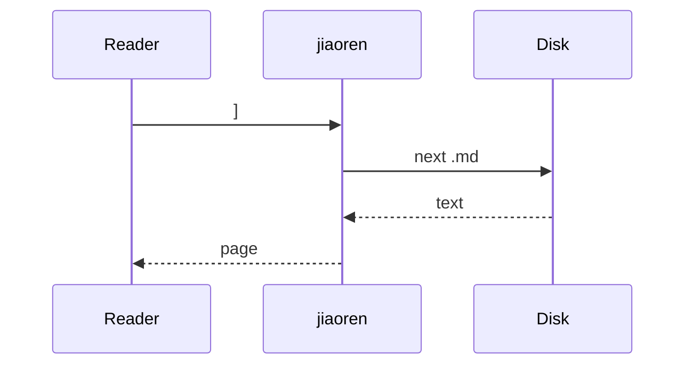

# Second note

Opened with `]` from `demo.md` — same folder, sorted by name. `[` goes back.

## Checklist

- [x] next/previous document
- [x] drag-release copies
- [x] zoom and theme remembered per session
- [ ] stop reading

## Small table

| Key | Does |
| --- | --- |
| `]` | next Markdown file here |
| `[` | previous Markdown file here |
| `o` | open the hovered link |

## Diagram

