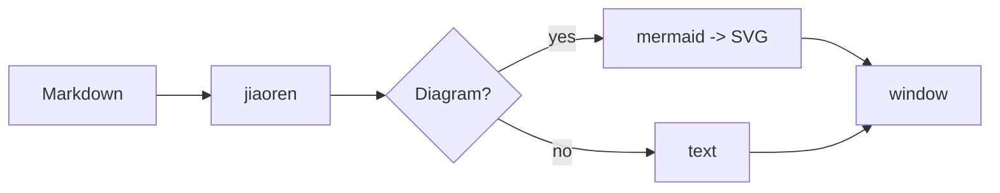

# jiaoren demo

A keyboard-first Markdown viewer: Markdown, diagrams and tables in one window.

## What it does

- Renders GitHub-flavoured Markdown with justified text
- Draws ```mermaid fences via a bundled headless Chromium
- Wraps tables to the reading column; click the icon to copy one as CSV
- `yy` copies the whole document as Markdown; `Ctrl+C` quits

## Diagram



## Table

| Key | Action |
| --- | --- |
| `j` / `k` | scroll a line |
| `t` | light / dark theme |
| `yy` | copy the document |
| `Ctrl+C` | quit |
