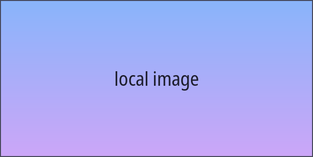
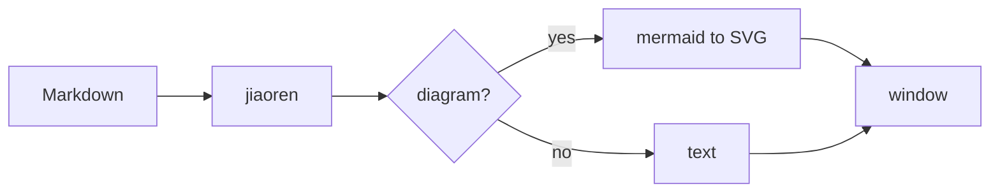

# jiaoren

A Markdown viewer in one window: justified prose, lists, tables and mermaid
diagrams — no browser tab, no editor.

## Text

Every paragraph is justified to the reading column, so both edges line up while
inline **bold**, *italic*, `code()` and [links](https://example.com) keep their
own styling. Long tokens such as
`src/db/schema.ts:293-311,1148-1175` break at separators instead of pushing the
table past the window. A [reference link][docs] and a bare
https://example.com/autolink work too.

- bullets wrap with a hanging indent
- long URLs like
  https://example.com/very/long/path/segment/abcdefghijklmnopqrstuvwxyz/0123456789
  stay inside the column
- [x] task done
- [ ] task left

1. ordered items share the same layout
2. second item

## Quote

> Level one
>
> > Level two with **bold**
> >
> > > Level three with `code`
>
> Back to level one.

## Table

| Feature | How | Note |
| --- | --- | --- |
| Copy table | click the icon | pastes as CSV |
| Copy document | `yy` | Markdown |
| Theme | `t` | Catppuccin |
| Quit | `Ctrl+C` | `q` closes the popup |
| Next note | `]` | same folder, then `[` back |

## Image



## Tall image

A 800×2000 screenshot is capped to 75% of the window height, so it cannot
swallow several viewports; click it to see the full picture in the zoom popup.


## Diagram



## Code

```rust
fn main() {
    // a deliberately long line: the soft wrap and the line-number gutter show here, and it keeps going past the column edge
    println!("jiaoren");
}
```

[docs]: https://example.com/docs
