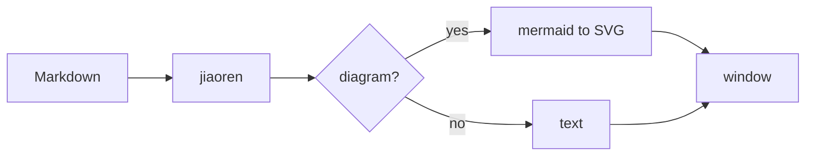

# jiaoren

A Markdown viewer in one window: justified prose, lists, tables and mermaid
diagrams — no browser tab, no editor.

## Text

Every paragraph is justified to the reading column, so both edges line up while
inline **bold**, *italic*, `code()` and [links](https://example.com) keep their
own styling. Long tokens such as
`src/db/schema.ts:293-311,1148-1175` break at separators instead of pushing the
table past the window.

- bullets wrap with a hanging indent
- long URLs like
  https://example.com/very/long/path/segment/abcdefghijklmnopqrstuvwxyz/0123456789
  stay inside the column
- [x] task done
- [ ] task left

1. ordered items share the same layout
2. second item

## Table

| Feature | How | Note |
| --- | --- | --- |
| Copy table | click the icon | pastes as CSV |
| Copy document | `yy` | Markdown |
| Theme | `t` | Catppuccin |
| Quit | `Ctrl+C` | `q` closes the popup |

## Diagram



## Code

```rust
fn main() {
    println!("jiaoren");
}
```
